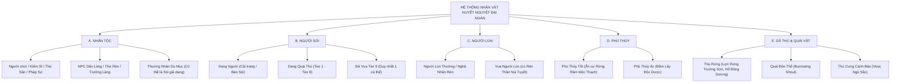
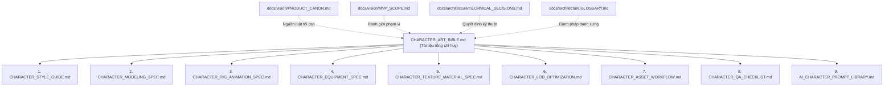

# HUYẾT NGUYỆT ĐẠI NGÀN — CHARACTER ART BIBLE
## Tài Liệu Tổng Chỉ Huy Sản Xuất Mỹ Thuật Nhân Vật 3D (Master Art Bible)

---

**Dự án:** Huyết Nguyệt Đại Ngàn  
**Mã tài liệu:** `CAB-MASTER-01`  
**Phiên bản:** `1.0.0`  
**Ngày cập nhật:** 31/10/2026  
**Trạng thái tài liệu:** `PROPOSED` (Đã đối chiếu tuân thủ Canon dự án ngày 31/10/2026, chờ phê duyệt chính thức từ Art Director & Project Lead)  
**Tác giả:** Đội ngũ chuyên gia mỹ thuật & kỹ thuật game (Art Director, Character Concept Artist, Senior 3D Character Artist, Technical Artist, Technical Animator, Asset Pipeline Architect, Documentation Engineer)  

---

## MỤC LỤC
1. [Mục Đích và Phạm Vi (Purpose and Scope)](#1-mục-đích-và-phạm-vi-purpose-and-scope)
2. [Định Hướng Nghệ Thuật (Project Art Direction)](#2-định-hướng-nghệ-thuật-project-art-direction)
3. [Bản Sắc Hình Ảnh (Visual Identity)](#3-bản-sắc-hình-ảnh-visual-identity)
4. [Các Trụ Cột Mỹ Thuật (Art Pillars)](#4-các-trụ-cột-mỹ-thuật-art-pillars)
5. [Triết Lý Thiết Kế Nhân Vật (Character Design Philosophy)](#5-triết-lý-thiết-kế-nhân-vật-character-design-philosophy)
6. [Phân Nhóm Nhân Vật (Character Categories)](#6-phân-nhóm-nhân-vật-character-categories)
7. [Tiêu Chuẩn Tỷ Lệ Nhân Vật (Character Proportion Standards)](#7-tiêu-chuẩn-tỷ-lệ-nhân-vật-character-proportion-standards)
8. [Hình Khối và Độ Nhận Diện (Silhouette and Readability)](#8-hình-khối-và-độ-nhận-diện-silhouette-and-readability)
9. [Kiến Trúc Nhân Vật Modular (Modular Character Architecture)](#9-kiến-trúc-nhân-vật-modular-modular-character-architecture)
10. [Nguyên Tắc Thiết Kế Trang Bị (Equipment Design Principles)](#10-nguyên-tắc-thiết-kế-trang-bị-equipment-design-principles)
11. [Ngôn Ngữ Màu Sắc và Vật Liệu (Material and Color Language)](#11-ngôn-ngữ-màu-sắc-và-vật-liệu-material-and-color-language)
12. [Triết Lý Rig và Animation (Rig and Animation Philosophy)](#12-triết-lý-rig-và-animation-rig-and-animation-philosophy)
13. [Quy Trình Sản Xuất Hỗ Trợ Bởi AI (AI-Assisted Production Workflow)](#13-quy-trình-sản-xuất-hỗ-trợ-bởi-ai-ai-assisted-production-workflow)
14. [Tích Hợp Giữa Blender và Unity (Blender and Unity Integration)](#14-tích-hợp-giữa-blender-và-unity-blender-and-unity-integration)
15. [Nguyên Tắc Tối Ưu và Hiệu Năng (Performance and Optimization Principles)](#15-nguyên-tắc-tối-ưu-và-hiệu-năng-performance-and-optimization-principles)
16. [Tiêu Chuẩn Chất Lượng (Quality Standards)](#16-tiêu-chuẩn-chất-lượng-quality-standards)
17. [Quản Trị Sản Xuất (Production Governance)](#17-quản-trị-sản-xuất-production-governance)
18. [Ma Trận Phụ Thuộc Tài Liệu (Document Dependencies)](#18-ma-trận-phụ-thuộc-tài-liệu-document-dependencies)
19. [Lịch Sử Thay Đổi (Revision History)](#19-lịch-sử-thay-đổi-revision-history)

---

## 1. MỤC ĐÍCH VÀ PHẠM VI (PURPOSE AND SCOPE)

### 1.1. Mục đích
Tài liệu **CHARACTER ART BIBLE** này là kim chỉ nam tối cao (*Master Art Reference*) định hình toàn bộ quy chuẩn hình ảnh, kỹ thuật mô hình 3D, vật liệu, khung xương (rig), diễn hoạt (animation) và quy trình sản xuất nhân vật cho dự án **Huyết Nguyệt Đại Ngàn**. 

Mục tiêu cốt lõi:
- Đảm bảo tính nhất quán hình ảnh mỹ thuật (*Artistic Cohesion*) xuyên suốt các khâu từ AI Concept, phác thảo 3D, dựng hình Blender đến tích hợp Prefab trong Unity 6 LTS URP.
- Cung cấp các thông số kỹ thuật chính xác, định lượng rõ ràng cho nghệ sĩ 3D và kỹ sư kỹ thuật (*Technical Artist*), loại bỏ hoàn toàn các suy đoán cảm tính.
- Đóng vai trò là tài liệu điều hướng trung tâm, liên kết chặt chẽ tới 9 tài liệu chuyên sâu thuộc thư mục [docs/art/character/](character/).

### 1.2. Phạm vi áp dụng
- **Dự án:** Game nhập vai sinh tồn thế giới mở theo vùng (3D Zone-based), góc nhìn Isometric 3/4, hỗ trợ nhiều người chơi mạng nội bộ (LAN 4–6 người).
- **Đối tượng áp dụng:** Toàn bộ thành viên phát triển dự án, nghệ sĩ đồ họa 3D, chuyên gia kỹ thuật diễn hoạt, kỹ sư tích hợp Unity, và các trợ lý AI hỗ trợ sản xuất (GPT-6 Astra, Gemini 4 Argon).
- **Ranh giới:** Tài liệu này **không** thay thế hay ghi đè các văn kiện kiến trúc cấp cao: [PRODUCT_CANON.md](../vision/PRODUCT_CANON.md), [MVP_SCOPE.md](../vision/MVP_SCOPE.md), [TECHNICAL_DECISIONS.md](../architecture/TECHNICAL_DECISIONS.md), [PROJECT_ROADMAP.md](../roadmap/PROJECT_ROADMAP.md). Mọi xung đột kỹ thuật đều tuân theo Thứ bậc Nguồn Sự Thật (*Hierarchy of Truth*).

---

## 2. ĐỊNH HƯỚNG NGHỆ THUẬT (PROJECT ART DIRECTION)

- **Phong cách chủ đạo:** **Stylized 3D Hand-Painted Fantasy** lấy cảm hứng từ cấu trúc thẩm mỹ của *Albion Online*, *Warcraft*, và *Torchlight*, nhưng sở hữu linh hồn văn hóa cổ truyền Việt Nam.
- **Góc nhìn máy quay:** **Isometric / 3/4 cố định** (góc nghiêng $45^\circ - 55^\circ$, độ cao tham chiếu $16\text{m}$, sử dụng Unity Cinemachine Virtual Camera) theo quyết định [ADR-02](../architecture/TECHNICAL_DECISIONS.md). Camera không xoay tự do $360^\circ$.
- **Đặc trưng thị giác:**
  - Hình khối lớn, cô đọng (*Chunky, bold shapes*), loại bỏ nhiễu hạt vi mô vô nghĩa ở góc máy xa.
  - Đường nét uốn lượn có chủ đích, vát cạnh rõ ràng (*Beveled stylized bevels*).
  - Bề mặt vẽ tay cách điệu (*Hand-painted stylized textures*) kết hợp với ánh sáng thời gian thực nhẹ của Universal Render Pipeline (URP).
  - Tương phản màu sắc mạnh mẽ giữa ban ngày bình dị thôn quê và màn đêm ngột ngạt dưới ánh Trăng Đỏ nguyền rủa.

---

## 3. BẢN SẮC HÌNH ẢNH (VISUAL IDENTITY)

Bản sắc của **Huyết Nguyệt Đại Ngàn** được xây dựng trên sự hòa quyện giữa ba tầng biểu tượng:

```
+-------------------------------------------------------------+
|               BẢN SẮC HÌNH ẢNH (VISUAL IDENTITY)             |
+-------------------------------------------------------------+
| 1. VĂN HÓA CỔ ĐẠI ĐÔNG SƠN & ĐẠI NGÀN VIỆT NAM              |
|    - Hoa văn Trống Đồng, Chim Lạc, Rồng gốm thời Lý/Trần     |
|    - Chất liệu bản địa: Tre nứa, gỗ trầm, đá suối, đồng đỏ   |
|    - Trang phục: Váy xòe thổ cẩm, áo tơi lá gồi, nón lá cách |
+-------------------------------------------------------------+
                              v
+-------------------------------------------------------------+
| 2. HUYỀN HUYỄN & LỜI NGUYỀN HUYẾT NGUYỆT (DARK FANTASY)     |
|    - Ánh sáng đỏ thẫm ma mị của đêm Nguyệt Thực             |
|    - Nanh vuốt biến dị, xương thú khắc chú văn, khói bùa chú |
|    - Biến thể Người Sói rách rưới lớp da cải trang du mục   |
+-------------------------------------------------------------+
                              v
+-------------------------------------------------------------+
| 3. QUY CHUẨN ĐỒ HỌA GAME STYLIZED CHUYÊN NGHIỆP             |
|    - Tỷ lệ cơ thể hơi cường điệu (Heroic 1:7 hoặc 1:6.5)     |
|    - Khối bàn tay, bàn chân, vũ khí phóng đại nhẹ (115-125%) |
|    - Không sa đà vào gai góc kim loại Châu Âu thời Trung Cổ |
+-------------------------------------------------------------+
```

> [!IMPORTANT]
> **Quy tắc bất biến:** Tuyệt đối không sao chép nguyên mẫu giáp trụ Gothic/Hiệp sĩ Thập Tự Chinh Tây phương. Mọi áo giáp nặng phải khai thác vảy đồng Đông Sơn, ngực áo da thuộc nẹp then đồng, vòng hộ tâm đúc nổi họa tiết mặt trời, xà cạp vải thô quấn bắp chân.

---

## 4. CÁC TRỤ CỘT MỸ THUẬT (ART PILLARS)

### Trụ cột 1: Đọc Rõ Ở Góc Máy Gameplay (Isometric Gameplay Readability)
Nhân vật được nhìn từ khoảng cách $14 - 18\text{m}$. Mọi chi tiết thiết kế trên đỉnh đầu, bờ vai, ngực trên và cánh tay cầm vũ khí phải được ưu tiên tuyệt đối. Các chi tiết nhỏ dưới thắt lưng hoặc gầm giáp được giản lược để tránh biến thành vết bẩn thị giác (*Visual Noise*).

### Trụ cột 2: Thổi Hồn Văn Hóa Đông Sơn (Ancient Vietnamese Craftsmanship)
Từng thanh kiếm, chiếc khiên, đường viền cổ áo đều toát lên bàn tay người thợ rèn đúc đồng, người đan lát tre nứa cổ đại. Không sử dụng công nghệ cơ khí hiện đại, ốc vít kim loại công nghiệp hay đèn neon ma pháp kiểu phương Tây.

### Trụ cột 3: Tiến Trình Hóa Trực Quan (Clear Visual Progression)
Nhìn vào nhân vật là nhận diện được ngay sức mạnh và trang bị:
- **Khởi đầu (Tier 1):** Vải thô, dây gai xơ xác, gỗ đẽo vội, da thú sờn rách.
- **Trung cấp (Tier 2–3):** Đồng hun bóng mờ, gỗ mun khắc chỉ vàng, da sói tuyết tuyết trắng, vảy đồng ép nhiệt.
- **Huyền thoại (Tier 4+):** Đồng đen huyền bí, bạc chạm khắc Linh Thạch nguyên tố phát quang huyền ảo.

### Trụ cột 4: Thích Ứng Hiệu Năng Thời Gian Thực (Multiplayer-Ready Performance)
Mỗi nhân vật và trang bị phải được thiết kế với ngân sách đa giác và số lệnh vẽ (*Draw Call*) được kiểm soát nghiêm ngặt nhằm duy trì khung hình ổn định trong các đợt tập kích 6 người chơi cùng 20 sói và 10 NPC ([ADR-12](../architecture/TECHNICAL_DECISIONS.md), [MVP_SCOPE.md](../vision/MVP_SCOPE.md)).

---

## 5. TRIẾT LÝ THIẾT KẾ NHÂN VẬT (CHARACTER DESIGN PHILOSOPHY)

Mỗi nhân vật trong thế giới Đại Ngàn không chỉ là một khối mô hình vô tri, mà là sự phản chiếu của sinh tồn và sự giằng xé nội tâm:

1. **Thực dụng và Bụi bặm:** Nhân vật sống sót giữa rừng thiêng nước độc. Giáp trụ có vết xước rìu, vải vóc có vết ố phèn, giầy dép lấm bùn đất.
2. **Hình khối kể chuyện (Narrative Shapes):**
   - **Khối Vuông / Trụ:** Đại diện cho sự kiên định, thợ rèn, hộ vệ làng, chiến binh Nhân Tộc.
   - **Khối Tam giác nhọn / Cắt chéo:** Đại diện cho sự nguy hiểm, tốc độ, móng vuốt Người Sói, quái thú ăn thịt.
   - **Khối Tròn / Bầu dục:** Đại diện cho thảo mộc, sự linh hoạt, pháp sư điều hòa nguyên tố, dân làng hiền lành.
3. **Quy tắc phân vùng thẩm mỹ 70/30:**
   - **70% Diện tích bề mặt:** Các mảng khối phẳng hoặc chuyển màu êm ái để mắt người chơi nghỉ ngơi.
   - **30% Diện tích bề mặt:** Vùng tập trung điểm nhấn văn hoa chi tiết cao (mặt trống đồng trước ngực, chuôi kiếm ngọc, họa tiết viền cổ áo).

---

## 6. PHÂN NHÓM NHÂN VẬT (CHARACTER CATEGORIES)

Hệ thống tài liệu quy chuẩn mỹ thuật bao quát 5 nhóm nhân vật cốt lõi:



> [!NOTE]
> **Đối chiếu MVP:** Toàn bộ 5 nhóm trên là tầm nhìn tổng thể. Tuy nhiên, theo [MVP_SCOPE.md](../vision/MVP_SCOPE.md), phạm vi sản xuất nhân vật 3D giai đoạn M8 chỉ yêu cầu: **01 Nhân vật người chơi (Human Base), Sói Bậc 1 (Feral Wolf), và Lợn Rừng Trường Sơn (Wild Boar)**. Các nhóm còn lại thuộc lộ trình M9–M12 hoặc hậu M12.

---

## 7. TIÊU CHUẨN TỶ LỆ NHÂN VẬT (CHARACTER PROPORTION STANDARDS)

Để đảm bảo góc nhìn Isometric đọc tốt mà không biến thành Chibi ngây ngô hay tả thực gầy guộc:

| Chủng Tộc / Nhân Vật | Chiều Cao Kỹ Thuật (Unity Meters) | Tỷ Lệ Đầu/Thân | Độ Cường Điệu Hình Khối | Mục Đích Thị Giác |
| :--- | :--- | :--- | :--- | :--- |
| **Nhân Tộc Nam (Nam Chiến Binh / Player)** | $1.80\text{m} \pm 0.05\text{m}$ | $1 : 6.8$ | Vai rộng $120\%$, Bàn tay $115\%$, Bàn chân $115\%$ | Trọng tâm vững chãi, nhận diện rõ vũ khí và thế thủ |
| **Nhân Tộc Nữ (Nữ Thợ Săn / Pháp Sư)** | $1.68\text{m} \pm 0.05\text{m}$ | $1 : 6.5$ | Thon gọn, Hông rộng, Bàn tay cầm trượng $110\%$ | Nhanh nhẹn, bay bổng, phân biệt rõ với Nam Chiến Binh |
| **Người Lùn (Dwarf Blacksmith / King)** | $1.25\text{m} \pm 0.05\text{m}$ | $1 : 4.5$ | Bề ngang thân $140\%$, Cánh tay $130\%$, Râu dài | Thấp đậm, lực lưỡng, như một khối đá tảng di động |
| **Phù Thủy Cổ Đại** | $1.72\text{m} \pm 0.05\text{m}$ | $1 : 7.0$ | Lưng hơi còng, Áo choàng rộng $130\%$, Trượng cao | Bí ẩn, cổ xưa, chuyển động tà áo thu hút sự chú ý |
| **Sói Bậc 1 (Tier 1 Feral Wolf - Quái)** | $1.30\text{m}$ (Cao vai 4 chân) | N/A | Bờm cổ nở to, Móng trước to, Bụng thắt | Dữ tợn, đói khát, lao nhanh như mũi tên |
| **Người Sói Dạng Người (Bán Sói / Giả Dạng)** | $1.85\text{m} \pm 0.05\text{m}$ | $1 : 6.8$ | Tư thế hơi khom gù $5^\circ$, Khớp ngón tay to | Dấu hiệu nghi kỵ ngầm khi đứng cạnh dân thường |
| **Người Sói Dạng Thú (Tier 3-5 Chiến Binh)** | $2.40\text{m} - 2.60\text{m}$ | $1 : 5.5$ | Cơ bắp thân trên $150\%$, Móng vuốt dài, Chân thú | Áp đảo hoàn toàn hình thể con người, đe dọa sinh tử |
| **Sói Vua Tier 9 (Boss Duy Nhất World)** | $3.20\text{m} - 3.50\text{m}$ | $1 : 5.0$ | Khối giáp đá/xương khổng lồ, Sừng huyết ngọc | Đỉnh cao quyền uy tối thượng, bóng đen trùm sàn đấu |

Chi tiết xem tại: [CHARACTER_STYLE_GUIDE.md](character/CHARACTER_STYLE_GUIDE.md) và [CHARACTER_MODELING_SPEC.md](character/CHARACTER_MODELING_SPEC.md).

---

## 8. HÌNH KHỐI VÀ ĐỘ NHẬN DIỆN (SILHOUETTE AND READABILITY)

### 8.1. Ba Cự Ly Đánh Giá Thị Giác (Three Inspection Distances)
Mọi nhân vật phải vượt qua bài kiểm tra nhận diện ở 3 khoảng cách:
1. **Góc Nhìn Cận Cảnh (Close View - $3\text{m}$):** Dùng trong Menu Trang Bị (`Inventory UI`), Bảng Đối Thoại NPC (`Dialogue Screen`). Yêu cầu chi tiết khuôn mặt sắc nét, hoa văn thêu dệt và vân kim loại tinh xảo.
2. **Góc Nhìn Trận Địa (Gameplay View - $16\text{m}$ - CỐT LÕI):** Góc nhìn chuẩn Isometric Cinemachine. Người chơi phải phân biệt được ngay trong $0.2\text{s}$: Chủng tộc là gì? Cầm vũ khí loại nào (Kiếm hay Cung)? Đang mặc giáp nặng hay áo tơi nhẹ? Đang ở trạng thái sẵn sàng hay vung đòn?
3. **Góc Nhìn Tầm Xa (Far View / Fog Edge - $25\text{m}$):** Ranh giới tầm nhìn sương mù ban đêm. Nhận diện hoàn toàn bằng viền bóng đen (*Pure Silhouette Outline*) và vệt mắt phát quang đỏ/vàng.

### 8.2. Quy Tắc Silhouette Tương Phản (High Contrast Silhouette)
- **Kiếm Sĩ / Giáp Nặng:** Khối giáp vai vuông nhô cao, tấm giáp ngực dầy, vũ khí cầm 1 tay dứt khoát hoặc 2 tay hạ thấp.
- **Thợ Săn / Giáp Nhẹ:** Vạt áo tơi bay lệch, nón lá nghiêng che nửa mặt, cánh cung tre dài uốn cong nổi bật sau lưng.
- **Pháp Sư / Vải:** Ống tay áo thụng rủ xuống, tà áo dài lướt trên mặt đất, trượng ma pháp dựng đứng có đá nguyên tố tỏa sáng.
- **Người Sói Chiến Binh:** Lưng gù gập hình chữ Z, hai cánh tay buông thõng chạm đất, cơ tam đầu cổ nhô cao hơn đỉnh đầu.

---

## 9. KIẾN TRÚC NHÂN VẬT MODULAR (MODULAR CHARACTER ARCHITECTURE)

Nhân vật người chơi được thiết kế theo cấu trúc **Ghép Khối Độc Lập (Modular Assembly System)** nhằm hỗ trợ thay đổi trang bị động mà không phát sinh hiện tượng đâm xuyên lưới (*Mesh Clipping*):

```
+-----------------------------------------------------------------------+
|                    KIẾN TRÚC NHÂN VẬT NGƯỜI CHƠI                       |
+-----------------------------------------------------------------------+
|  LOGIC ROOT (GameObject: Player)                                      |
|  - CharacterController (Radius 0.4m, Height 1.8m)                     |
|  - PlayerMovementController.cs, PlayerCombatController.cs             |
|  - HealthComponent.cs, PlayerStatsComponent.cs                        |
+-----------------------------------------------------------------------+
                                   | (Decoupled Hierarchy)
                                   v
+-----------------------------------------------------------------------+
|  VISUAL ROOT (GameObject: PlayerVisual - Z-Forward, Y-Up)             |
|  - Animator (Avatar Humanoid Mecanim)                                 |
|  - PlayerVisualAnimationBridge.cs                                     |
|  +-- Root Bone (Pelvis / Hips)                                        |
|  |   +-- Spine -> Chest -> Neck -> Head                               |
|  |   +-- Left/Right UpperArm -> Forearm -> Hand                       |
|  |   +-- Left/Right Thigh -> Calf -> Foot                             |
|  +-- SKINNED MESH SLOTS (Thay thế lưới gắn xương):                    |
|  |   1. Head / Hair (Đầu & Tóc)                                       |
|  |   2. Chest Armor (Giáp Thân Trên - Che thân trong)                 |
|  |   3. Gloves (Găng Tay)                                             |
|  |   4. Pants / Legs (Giáp Quần / Váy Đầm)                            |
|  |   5. Boots (Ủng Chân)                                              |
|  +-- SOCKET ATTACHMENTS (Khớp gắn cứng theo xương):                   |
|      1. Socket_Head_Hat (Nón lá, Mũ lông sói)                         |
|      2. Socket_Shoulder_L / R (Giáp vai phi đối xứng)                 |
|      3. Socket_Back_Cape (Áo choàng lông thú)                         |
|      4. Socket_Weapon_R (Vũ khí chính: Kiếm, Rìu, Cung)               |
|      5. Socket_Shield_L (Khiên đồng, Ngọn đuốc)                       |
+-----------------------------------------------------------------------+
```

Chi tiết xem tại: [CHARACTER_EQUIPMENT_SPEC.md](character/CHARACTER_EQUIPMENT_SPEC.md).

---

## 10. NGUYÊN TẮC THIẾT KẾ TRANG BỊ (EQUIPMENT DESIGN PRINCIPLES)

1. **Tuân thủ triết lý Albion Online:** "Bạn là những gì bạn mặc" (*You are what you wear*). Không khóa cứng class nhân vật; kỹ năng chủ động gắn liền với món trang bị trên người theo [ADR-06](../architecture/TECHNICAL_DECISIONS.md).
2. **Khắc phục triệt để Clipping (Xuyên Mesh):**
   - Áp dụng kỹ thuật **Ẩn Thân Trong (Body Mesh Slicing/Hiding)**: Khi mặc giáp thân trên dạng kín, phần thịt ngực và bụng của mô hình gốc tự động được ẩn (`renderer.enabled = false` hoặc cắt thành submesh riêng biệt).
3. **Phân cấp trang bị rõ ràng:**
   - **Giáp Vải / Da Thô (T1):** Nón lá cọ, áo tơi dừa rách gấu, quần thô bó cẳng chân.
   - **Giáp Da Đúc & Đồng Thô (T2):** Giáp hộ tâm đúc hình mắt trời Đông Sơn, xà cạp da lợn rừng.
   - **Giáp Vảy Bạc & Lông Sói (T3):** Giáp phiến đan chỉ bạc, áo choàng lông sói tuyết viền chỉ điều (Điển hình: Nhân vật tham chiếu *Silver Wolf Knight*).
4. **Không áp dụng hệ thống giáp người lên Lốt Sói:** Khi hóa Sói, toàn bộ trang bị Người được ẩn; hình dạng Sói chỉ mang các đặc trưng bùa chú, vòng sắt găm da hoặc ngọc ấn trên cơ thể.

---

## 11. NGÔN NGỮ MÀU SẮC VÀ VẬT LIỆU (MATERIAL AND COLOR LANGUAGE)

### 11.1. Bảng màu theo Phe Phái (Faction Color Palette)
- **Phe Nhân Tộc (Sinh Tồn / Xây Làng):** Màu đất nung ($#8B4513$), màu xanh tre ngà ($#6B8E23$), màu nâu da thuộc ($#5C4033$), điểm xuyết vàng kim Đông Sơn ($#D4AF37$). Toát lên vẻ ấm áp, bình dị nhưng quật cường.
- **Phe Người Sói & Huyết Nguyệt (Thợ Săn Bóng Tối):** Màu đỏ máu tươi trăng khuyết ($#8B0000$), màu tro than xám đen ($#2F4F4F$), màu bạc lạnh ánh trăng ($#C0C0C0$), màu tím độc đầm lầy ($#4B0082$).
- **Ngũ Linh Thạch:** Ánh hào quang nguyên tố thuần khiết: Hỏa ($#FF4500$), Thủy ($#1E90FF$), Thổ ($#CD853F$), Mộc ($#32CD32$), Hàn ($#00FFFF$).

### 11.2. Đặc tả vật liệu Stylized URP
- Dự án sử dụng **Universal Render Pipeline (URP Lit Shader)** với quy chuẩn nướng ánh sáng giả lập (*Stylized Light Baking*):
  - **Base Map (Albedo):** Đã được vẽ sẵn sắc thái ánh sáng trên cao rọi xuống (*Top-down Ambient Occlusion & Gradient Light*). Màu tối ấm, màu sáng lạnh nhẹ.
  - **Metallic / Smoothness:** Giữ dải mờ rộng (*Roughness $0.5 - 0.8$*), không làm phản chiếu sắc cạnh như gương thực tế để giữ phong cách hoạt họa.
  - **Emission:** Chỉ dành riêng cho mắt sói ban đêm, đường vân bùa chú trên vũ khí và Linh Thạch.

Chi tiết xem tại: [CHARACTER_TEXTURE_MATERIAL_SPEC.md](character/CHARACTER_TEXTURE_MATERIAL_SPEC.md).

---

## 12. TRIẾT LÝ RIG VÀ ANIMATION (RIG AND ANIMATION PHILOSOPHY)

1. **Khung xương chuẩn Unity Humanoid:** Mọi nhân vật dạng người (Player, Dân Làng, Du Mục, Thợ Rèn) dùng chung khung xương chuẩn Mecanim Humanoid để tái sử dụng toàn bộ thư viện hoạt cảnh.
2. **Khung xương Dã Thú Chuyên Biệt (Wolf Quadruped/Beast Rig):** Sử dụng hệ xương 4 chân có đốt đuôi, xương hàm răng sắc nhọn, và xương tai độc lập.
3. **Chính sách In-Place Animation (Bắt buộc cho Networked Game):**
   - Toàn bộ hoạt cảnh di chuyển (Walk, Run, Sprint, Roll/Dodge) phải thực hiện **In-Place (Tại chỗ)**.
   - Vận tốc và vị trí được tính toán và điều khiển 100% bằng mã nguồn `CharacterController.Move()` để đảm bảo đồng bộ mượt mà qua mạng LAN 4–6 người chơi và hỗ trợ chuyển giao máy chủ phòng (*Host Migration*) theo [ADR-09](../architecture/TECHNICAL_DECISIONS.md). Tuyệt đối không bật Root Motion vật lý bừa bãi.
4. **Nhịp hoạt cảnh tấn công Snappy (Snappy Action Timing):**
   - Đòn chém có pha ra đòn thần tốc (*Anticipation 2-3 frames, Strike 1 frame*), giữ nguyên tư thế vung kiếm để cảm nhận trọng lượng (*Hold/Impact 4-6 frames*), và thu chiêu êm ái (*Recovery*).

Chi tiết xem tại: [CHARACTER_RIG_ANIMATION_SPEC.md](character/CHARACTER_RIG_ANIMATION_SPEC.md).

---

## 13. QUY TRÌNH SẢN XUẤT HỖ TRỢ BỞI AI (AI-ASSISTED PRODUCTION WORKFLOW)

Theo quyết định [ADR-08](../architecture/TECHNICAL_DECISIONS.md) và ghi nhận rủi ro [R-15](../roadmap/RISK_REGISTER.md), quy trình sản xuất tuân thủ triệt để nguyên tắc: **AI là bàn đạp tạo ý tưởng và bản nháp — Bàn tay con người là chốt chặn kỹ thuật và nghiệm thu cuối cùng**.

```
[ Ý Tưởng Lore & Game Design ]
            |
            v
[ GIAI ĐOẠN 1: AI 2D Concept & Orthographic Generation ]
  - Công cụ: Midjourney v6 / Stable Diffusion XL / ComfyUI
  - Đầu ra: Tranh Concept phong cách Stylized Đông Sơn, Turnaround 3 góc (Trước, Nghiêng, Sau)
            |
            v
[ GIAI ĐOẠN 2: AI-Assisted 3D Blockout ]
  - Công cụ: Rodin / Meshy / Tripo3D
  - Đầu ra: Bản nháp 3D OBJ/FBX sơ khai (Chỉ dùng lấy khối thể tích - KHÔNG ĐƯA THẲNG VÀO GAME)
            |
            v
[ GIAI ĐOẠN 3: Blender Topology Cleanup & Remodeling ]
  - Nghệ sĩ 3D: Retopology chuẩn Edge Loop, nắn chuẩn tỷ lệ 1.8m, gọt mỏng đa giác
  - Phân tách Modular Submesh (Đầu, Thân, Tay, Chân, Khớp nối)
            |
            v
[ GIAI ĐOẠN 4: UV Unwrapping & Stylized Texturing ]
  - Trải UV tối ưu Texel Density (10.24 px/cm), gộp Atlas
  - Vẽ Texturing (Substance Painter / 3DCoat / Blender Texture Paint)
            |
            v
[ GIAI ĐOẠN 5: Rigging & Skinning ]
  - Khung xương Humanoid / Rigify / Mixamo skeleton chuẩn hóa
  - Weight Painting khử lỗi co dúm nách và đáy chậu
            |
            v
[ GIAI ĐOẠN 6: Unity Integration & Technical QA ]
  - Import FBX vào Unity 6 URP, cấu hình Prefab `PlayerVisual`
  - Chạy bộ kiểm tra tự động và nghiệm thu bằng Checklist
```

Chi tiết xem tại: [CHARACTER_ASSET_WORKFLOW.md](character/CHARACTER_ASSET_WORKFLOW.md) và thư viện prompt chuyên biệt [AI_CHARACTER_PROMPT_LIBRARY.md](character/AI_CHARACTER_PROMPT_LIBRARY.md).

---

## 14. TÍCH HỢP GIỮA BLENDER VÀ UNITY (BLENDER AND UNITY INTEGRATION)

Để đảm bảo không bao giờ gặp lỗi lệch trục xoay $90^\circ$ hoặc tỷ lệ méo mó khi chuyển đổi tài nguyên giữa Blender và Unity:

1. **Thiết lập Scene Blender:**
   - Unit System: `Metric`.
   - Unit Scale: `1.0` (Chính xác: $1.0\text{ Blender Unit} = 1.0\text{ Meter} = 1.0\text{ Unity Unit}$).
   - Hướng mặt mặc định: **$-Y$ Forward, $+Z$ Up** (Khi xuất FBX sang Unity sẽ tự chuyển thành $+Z$ Forward, $+Y$ Up hoàn hảo).
2. **Quy tắc Transform bắt buộc trước khi Export:**
   - Toàn bộ Mesh và Armature phải được: **Apply All Transforms (Ctrl + A $\to$ Rotation & Scale)**.
   - Scale phải là $(1.0, 1.0, 1.0)$, Rotation là $(0^\circ, 0^\circ, 0^\circ)$.
   - Gốc tọa độ Pivot Point của nhân vật nằm chính xác tại điểm giữa hai gót chân chạm mặt sàn: $(0, 0, 0)$.
3. **Cấu hình Cây Thư Mục Unity Dự Án:**
   - Toàn bộ model nhân vật lưu tại: `Assets/_Project/Art/Characters/`
   - Toàn bộ trang bị tách rời: `Assets/_Project/Art/Equipment/`
   - Toàn bộ vũ khí cầm tay: `Assets/_Project/Art/Weapons/`
   - Prefab lắp ghép hoàn chỉnh: `Assets/_Project/Prefabs/Characters/`

Chi tiết xem tại: [CHARACTER_MODELING_SPEC.md](character/CHARACTER_MODELING_SPEC.md).

---

## 15. NGUYÊN TẮC TỐI ƯU VÀ HIỆU NĂNG (PERFORMANCE AND OPTIMIZATION PRINCIPLES)

Dựa trên cấu hình kiểm thử mục tiêu [ADR-12](../architecture/TECHNICAL_DECISIONS.md) (Fixture: 6 người chơi + 20 sói + 10 NPC + 30 công trình trong trận công thành Đêm Huyết Nguyệt):

### 15.1. Ngân sách Đa giác (Polygon Budget) — [PROPOSED & BENCHMARK NEEDED]
- **Nhân vật Người Chơi / Hero NPC (LOD0):** $8,000 - 12,000$ Triangles (toàn bộ trang bị ghép lại).
- **LOD1 ($15 - 25\text{m}$):** $4,000 - 6,000$ Triangles (giảm $50\%$).
- **LOD2 ($> 25\text{m}$):** $1,500 - 2,500$ Triangles (giảm $75\%$).
- **Sói Thường / Quái Tiểu Quái (LOD0):** $3,000 - 5,000$ Triangles.
- **Sói Vua Boss (LOD0):** $15,000 - 20,000$ Triangles (cá thể duy nhất world).

### 15.2. Ngân sách Lệnh Vẽ và Vật Liệu (Draw Calls & Materials)
- Mỗi nhân vật hoàn chỉnh chỉ được phép chiếm tối đa **$1 - 2$ Material** (Dùng chung Texture Atlas).
- Tương thích $100\%$ với **SRP Batcher** và tính năng **GPU Resident Drawer** mới của Unity 6 LTS.
- Số xương ảnh hưởng tối đa trên mỗi đỉnh (`Skin Weights`): **4 Bones** ở LOD0, giảm còn **2 Bones** hoặc 1 Bone ở LOD2.

Chi tiết xem tại: [CHARACTER_LOD_OPTIMIZATION.md](character/CHARACTER_LOD_OPTIMIZATION.md).

---

## 16. TIÊU CHUẨN CHẤT LƯỢNG (QUALITY STANDARDS)

Một tài sản nhân vật 3D chỉ được đóng dấu xuất xưởng (**APPROVED FOR ENGINE INTEGRATION**) khi thỏa mãn đồng thời 5 tiêu chí:
1. **Độ trung thực Concept (Concept Fidelity):** Giữ đúng linh hồn giáp vảy đồng Đông Sơn, chất dã thú của Sói và phong thái cổ phong Đại Ngàn.
2. **Độ sạch Topology (Clean Topology):** Lưới quad chiếm $>90\%$, không có n-gon ($>4$ cạnh), không có đỉnh cô lập, edge loops quanh miệng, mắt, nách, đầu gối biến dạng không bị nhăn rách.
3. **Chuẩn xác UV & Texture (Texel Uniformity):** Không méo UV ở các vùng cong, không lãng phí quá $25\%$ khoảng trống UV sheet.
4. **Không lỗi diễn hoạt (Deformation Rig Check):** Uốn gập tay chân $90^\circ - 120^\circ$ không làm lún méo thể tích (Volume Loss).
5. **Đạt chuẩn kiểm định QA:** Vượt qua toàn bộ các mục nghiêm ngặt trong [CHARACTER_QA_CHECKLIST.md](character/CHARACTER_QA_CHECKLIST.md).

---

## 17. QUẢN TRỊ SẢN XUẤT (PRODUCTION GOVERNANCE)

### 17.1. Quy tắc phân định trạng thái thông số
Mọi số liệu trong hệ thống tài liệu Art Bible phải được gắn nhãn rõ ràng:
- `[CONFIRMED]`: Đã được chốt trong Product Canon / ADR kiến trúc đã duyệt.
- `[PROPOSED]`: Đề xuất kỹ thuật mới từ đội ngũ chuyên gia, cần thử nghiệm thực tế.
- `[PENDING BENCHMARK]`: Cần đo đạc FPS/Draw Calls trên máy yếu nhất của team trước khi cố định.
- `[PENDING APPROVAL]`: Chờ chữ ký phê duyệt từ Project Lead.
- `[DEPRECATED]`: Đã bị hủy bỏ theo quyết định mới.

### 17.2. Nhân vật tham chiếu tiên phong (First Reference Character)
- **Tên nhận diện concept:** **Bạch Lang Kiếm Sĩ (Silver Wolf Knight)**.
- **Vai trò sản xuất:** Là nhân vật "Chuột Bạch" (*Pioneer Benchmark Asset*) đầu tiên được đưa qua trọn vẹn 12 bước của pipeline sản xuất để thiết lập chuẩn mực kích thước, lưới, vật liệu và Prefab mẫu trước khi nhân rộng sản xuất hàng loạt.

---

## 18. MA TRẬN PHỤ THUỘC TÀI LIỆU (DOCUMENT DEPENDENCIES)



| Tên Tài Liệu Chi Tiết | Liên Kết Tương Đối | Trọng Tâm Trách Nhiệm | Vai Trò Phụ Trách |
| :--- | :--- | :--- | :--- |
| **Character Style Guide** | [CHARACTER_STYLE_GUIDE.md](character/CHARACTER_STYLE_GUIDE.md) | Thẩm mỹ, tỷ lệ, hình khối, bảng màu, họa tiết Việt | Art Director & Concept Artist |
| **Character Modeling Spec** | [CHARACTER_MODELING_SPEC.md](character/CHARACTER_MODELING_SPEC.md) | Dựng hình 3D, Blender setup, topology, poly budget | Senior 3D Character Artist |
| **Rig & Animation Spec** | [CHARACTER_RIG_ANIMATION_SPEC.md](character/CHARACTER_RIG_ANIMATION_SPEC.md) | Khung xương Humanoid/Wolf, Animation clips, in-place | Character Technical Animator |
| **Equipment Spec** | [CHARACTER_EQUIPMENT_SPEC.md](character/CHARACTER_EQUIPMENT_SPEC.md) | Kiến trúc modular, socket gắn đồ, thay giáp | Technical Artist & Systems Eng |
| **Texture & Material Spec**| [CHARACTER_TEXTURE_MATERIAL_SPEC.md](character/CHARACTER_TEXTURE_MATERIAL_SPEC.md) | UV layout, hand-painted, shader URP, vật liệu | Senior Texture / Tech Artist |
| **LOD & Optimization** | [CHARACTER_LOD_OPTIMIZATION.md](character/CHARACTER_LOD_OPTIMIZATION.md) | Culling, LODGroup, Draw call, GPU Resident Drawer | Technical Artist & QA Lead |
| **Asset Workflow** | [CHARACTER_ASSET_WORKFLOW.md](character/CHARACTER_ASSET_WORKFLOW.md) | Pipeline 12 bước từ AI concept đến Unity Prefab | Game Asset Pipeline Architect |
| **QA Checklist** | [CHARACTER_QA_CHECKLIST.md](character/CHARACTER_QA_CHECKLIST.md) | Nghiệm thu 13 tiêu chí: Pass/Fail/Blocked | Lead QA & Technical Artist |
| **AI Prompt Library** | [AI_CHARACTER_PROMPT_LIBRARY.md](character/AI_CHARACTER_PROMPT_LIBRARY.md) | 22 bộ prompt sản xuất độc lập cho AI 2D/3D | Concept Artist & Pipeline Eng |

---

## 19. LỊCH SỬ THAY ĐỔI (REVISION HISTORY)

| Phiên Bản | Ngày | Tác Giả | Nội Dung Thay Đổi Chính | Trạng Thái |
| :--- | :--- | :--- | :--- | :--- |
| `1.0.0` | 31/10/2026 | Ban Mỹ Thuật & Kỹ Thuật | Khởi tạo toàn diện bộ tài liệu Master Art Bible theo cấu trúc chuẩn hóa, tích hợp quyết định Canon 31/10/2026. | `PROPOSED` |
