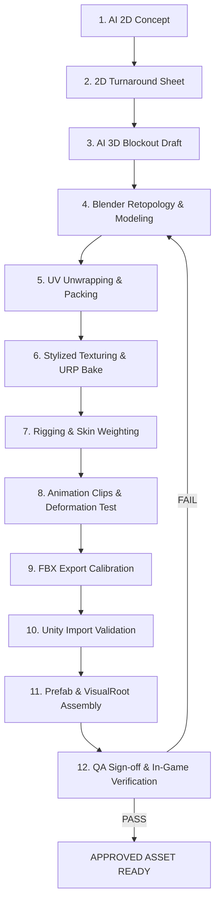

# QUY TRÌNH SẢN XUẤT TÀI SẢN NHÂN VẬT 3D TOÀN DIỆN
## (END-TO-END CHARACTER ASSET WORKFLOW — AI TO UNITY)

---

**Dự án:** Huyết Nguyệt Đại Ngàn  
**Mã tài liệu:** `CAB-SPEC-07`  
**Phiên bản:** `1.0.0`  
**Ngày cập nhật:** 31/10/2026  
**Trạng thái tài liệu:** `PROPOSED` (Chuẩn hóa quy trình sản xuất thực chiến)  
**Tài liệu cha:** [CHARACTER_ART_BIBLE.md](../CHARACTER_ART_BIBLE.md)  
**Tác giả:** Game Asset Pipeline Architect & Technical Artist  

---

## MỤC LỤC
1. [Sơ Đồ Quy Trình Sản Xuất 12 Giai Đoạn (Workflow Overview)](#1-sơ-đồ-quy-trình-sản-xuất-12-giai-đoạn-workflow-overview)
2. [Phân Định Rõ Ràng: Bản Nháp AI vs Tài Sản Game-Ready](#2-phân-định-rõ-ràng-bản-nháp-ai-vs-tài-sản-game-ready)
3. [Đặc Tả Chi Tiết 12 Giai Đoạn Sản Xuất](#3-đặc-tả-chi-tiết-12-giai-đoạn-sản-xuất)
   - [Giai đoạn 1: Khởi Tạo Ý Tưởng & 2D Concept Bằng AI](#giai-đoạn-1-khởi-tạo-ý-tưởng--2d-concept-bằng-ai)
   - [Giai đoạn 2: Tạo Bản Vẽ Chi Tiết 3 Góc (Orthographic Turnaround)](#giai-đoạn-2-tạo-bản-vẽ-chi-tiết-3-góc-orthographic-turnaround)
   - [Giai đoạn 3: Phác Thảo Khối Thể Tích 3D Bằng AI (AI 3D Blockout)](#giai-đoạn-3-phác-thảo-khối-thể-tích-3d-bằng-ai-ai-3d-blockout)
   - [Giai đoạn 4: Dọn Dẹp Lưới & Dựng Hình Trong Blender (Topology & Remodeling)](#giai-đoạn-4-dọn-dẹp-lưới--dựng-hình-trong-blender-topology--remodeling)
   - [Giai đoạn 5: Trải UV & Tối Ưu Hóa Texel Density](#giai-đoạn-5-trải-uv--tối-ưu-hóa-texel-density)
   - [Giai đoạn 6: Vẽ Texture Stylized & Nướng Vật Liệu URP](#giai-đoạn-6-vẽ-texture-stylized--nướng-vật-liệu-urp)
   - [Giai đoạn 7: Gắn Khung Xương & Quét Trọng Lượng (Rigging & Skinning)](#giai-đoạn-7-gắn-khung-xương--quét-trọng-lượng-rigging--skinning)
   - [Giai đoạn 8: Thiết Kế Hoạt Cảnh & Kiểm Thử Biến Dạng (Animation & Deformation)](#giai-đoạn-8-thiết-kế-hoạt-cảnh--kiểm-thử-biến-dạng-animation--deformation)
   - [Giai đoạn 9: Cấu Hình & Xuất File FBX Chuẩn Hóa](#giai-đoạn-9-cấu-hình--xuất-file-fbx-chuẩn-hóa)
   - [Giai đoạn 10: Nhập Khẩu & Xác Thực Trong Unity (Unity Import Validation)](#giai-đoạn-10-nhập-khẩu--xác-thực-trong-unity-unity-import-validation)
   - [Giai đoạn 11: Đóng Gói Prefab & Tích Hợp VisualRoot](#giai-đoạn-11-đóng-gói-prefab--tích-hợp-visualroot)
   - [Giai đoạn 12: Nghiệm Thu Kỹ Thuật & Ký Duyệt Sản Phẩm (QA Sign-off)](#giai-đoạn-12-nghiệm-thu-kỹ-thuật--ký-duyệt-sản-phẩm-qa-sign-off)
4. [Kế Hoạch Khắc Phục Khi Gặp Lỗi Handoff (Handoff Failure Recovery)](#4-kế-hoạch-khắc-phục-khi-gặp-lỗi-handoff-handoff-failure-recovery)
5. [Theo Dõi Minh Họa: Tiến Trình Thực Tế Của "Bạch Lang Kiếm Sĩ"](#5-theo-dõi-minh-họa-tiến-trình-thực-tế-của-bạch-lang-kiếm-sĩ)

---

## 1. SƠ ĐỒ QUY TRÌNH SẢN XUẤT 12 GIAI ĐOẠN (WORKFLOW OVERVIEW)



---

## 2. PHÂN ĐỊNH RÕ RÀNG: BẢN NHÁP AI VS TÀI SẢN GAME-READY

Theo quyết định kiến trúc [ADR-08](../../architecture/TECHNICAL_DECISIONS.md) và cảnh báo rủi ro [RISK_REGISTER.md R-15](../../roadmap/RISK_REGISTER.md):

```
+-------------------------------------------------------------------------+
|                  ĐỐI CHIẾU: BẢN NHÁP AI VS GAME-READY                   |
+-------------------------------------------------------------------------+
| [ BẢN NHÁP DO AI SINH RA (AI-GENERATED DRAFT) ]                        |
| - Đặc điểm: Lưới đa giác hỗn loạn (Triangles/N-gons ngẫu nhiên).        |
| - Khung xương: Không có hoặc tự động sinh xương lệch tâm.               |
| - UV/Texture: UV nướng tự động nát vụn (Thousands of tiny islands).     |
| - Tỷ lệ: Kích thước ngẫu nhiên, không khớp 1 Unity Unit = 1 Meter.     |
| - ĐÁNH GIÁ: CHỈ LÀ PHÔI THAM KHẢO KHỐI - TUYỆT ĐỐI KHÔNG ĐƯA VÀO BUILD! |
+-------------------------------------------------------------------------+
                                   | (Được chỉnh sửa thủ công qua Blender)
                                   v
+-------------------------------------------------------------------------+
| [ TÀI NGUYÊN HOÀN CHỈNH (PRODUCTION-READY ASSET) ]                     |
| - Đặc điểm: Lưới Quad > 90%, Edge loop chuẩn khớp uốn, đúng ngân sách.  |
| - Khung xương: Chuẩn Unity Mecanim Humanoid 53 xương, gốc Root (0,0,0).  |
| - UV/Texture: Atlas gom gọn gàng, Texel Density đồng nhất 10.24 px/cm.   |
| - Tích hợp: Prefab lắp khớp VisualRoot, tương thích SRP Batcher.        |
+-------------------------------------------------------------------------+
```

---

## 3. ĐẶC TẢ CHI TIẾT 12 GIAI ĐOẠN SẢN XUẤT

### Giai đoạn 1: Khởi Tạo Ý Tưởng & 2D Concept Bằng AI
- **Đầu vào (Input):** Mô tả lore, nhân vật, vai trò và phân cấp trang bị từ GDD và [CHARACTER_STYLE_GUIDE.md](CHARACTER_STYLE_GUIDE.md).
- **Vai trò chịu trách nhiệm:** Character Concept Artist & Art Director.
- **Công cụ:** Midjourney v6 / Stable Diffusion XL / ComfyUI sử dụng thư viện prompt tại [AI_CHARACTER_PROMPT_LIBRARY.md](AI_CHARACTER_PROMPT_LIBRARY.md).
- **Hành động thực hiện:** Sinh hàng loạt mẫu ý tưởng ($10 - 20$ ảnh), chọn lọc ra 1 mẫu đại diện xuất sắc nhất thể hiện đúng bản sắc Đông Sơn.
- **Đầu ra (Output):** 01 Ảnh concept độ phân giải cao, góc nhìn 3/4 Isometric.
- **Quy tắc đặt tên:** `Concept_2D_[Species]_[Name]_v01.png`.
- **Tiêu chuẩn nghiệm thu:** Đúng tỷ lệ Stylized 1:6.8, giáp vảy đồng/da sấy khói, silhouette dễ đọc.
- **Điều kiện thất bại:** Ảnh mang phong cách Hiệp sĩ Thập Tự Chinh châu Âu, quá nhiều chi tiết rối rắm.
- **Yêu cầu bàn giao:** File ảnh PNG không nén gửi sang Giai đoạn 2.

---

### Giai đoạn 2: Tạo Bản Vẽ Chi Tiết 3 Góc (Orthographic Turnaround)
- **Đầu vào:** Ảnh Concept đã duyệt ở Giai đoạn 1.
- **Vai trò chịu trách nhiệm:** Character Concept Artist.
- **Công cụ:** Photoshop / Krita / SDXL Inpainting / ControlNet OpenPose.
- **Hành động thực hiện:** Vẽ hoặc dùng AI sinh bản vẽ chiếu trực giao (*Orthographic Projection*) ở tư thế A-Pose: Góc nhìn Thẳng (Front View), Góc nhìn Nghiêng (Side View), Góc nhìn Sau Lưng (Back View). Kẻ sẵn các đường gióng đồng mức: Đỉnh đầu, Mắt, Vai, Hông, Gối, Gót chân.
- **Đầu ra:** 01 File ảnh Turnaround Sheet chuẩn xác.
- **Quy tắc đặt tên:** `Ref_Turnaround_[Species]_[Name]_Apose.png`.
- **Tiêu chuẩn nghiệm thu:** Chiều cao và vị trí các khớp chân tay giữa 3 góc chiếu phải thẳng hàng tuyệt đối.
- **Điều kiện thất bại:** Lệch tỷ lệ chân tay giữa góc thẳng và góc nghiêng.
- **Yêu cầu bàn giao:** Bàn giao tấm tham chiếu cho Nghệ sĩ 3D.

---

### Giai đoạn 3: Phác Thảo Khối Thể Tích 3D Bằng AI (AI 3D Blockout)
- **Đầu vào:** Bản vẽ Turnaround Sheet từ Giai đoạn 2.
- **Vai trò chịu trách nhiệm:** Technical Artist & Senior 3D Character Artist.
- **Công cụ:** Rodin Gen-1 / Tripo3D / Meshy.
- **Hành động thực hiện:** Nạp ảnh Turnaround vào công cụ Image-to-3D để tạo mô hình blockout thô, lấy thể tích khối cơ bắp và dáng áo choàng.
- **Đầu ra:** File nháp `Draft_AI_Blockout_[Name].obj`.
- **Quy tắc đặt tên:** `Draft_AI_Blockout_[Species]_[Name].obj`.
- **Tiêu chuẩn nghiệm thu:** Thể tích tổng thể khớp $80\%$ hình khối 2D.
- **Điều kiện thất bại:** Lưới bị rỗng ruột nghiêm trọng hoặc biến dạng méo mó hình người.
- **Yêu cầu bàn giao:** Nhập file OBJ vào Blender để thực hiện Giai đoạn 4.

---

### Giai đoạn 4: Dọn Dẹp Lưới & Dựng Hình Trong Blender (Topology & Remodeling)
- **Đầu vào:** File nháp OBJ từ Giai đoạn 3 và Turnaround Sheet.
- **Vai trò chịu trách nhiệm:** Senior 3D Character Artist.
- **Công cụ:** Blender 4.2 LTS (Modifier Shrinkwrap, BSurfaces, Retopology tools).
- **Hành động thực hiện:** 
  1. Đặt Scale Scene chuẩn Metric $1.0\text{m}$. Căn chỉnh chiều cao nhân vật đúng $1.80\text{m}$.
  2. Dựng lại lưới sạch (Retopology): $100\%$ bằng Quad, nắn các vòng edge loops ở vai, khuỷu tay, đầu gối theo [CHARACTER_MODELING_SPEC.md](CHARACTER_MODELING_SPEC.md).
  3. Phân tách các Submesh Modular: Đầu, Giáp Thân, Tay, Chân, Vũ khí.
  4. Đạt chuẩn ngân sách LOD0 ($8,000 - 12,000$ Tris).
- **Đầu ra:** File `CH_[Species]_[Name]_Modeling_LOD0.blend`.
- **Tiêu chuẩn nghiệm thu:** Không có N-gons, không có đỉnh rác, Transform Scale $(1, 1, 1)$, Pivot tại chân $(0, 0, 0)$.
- **Điều kiện thất bại:** Lưới quá dày ($> 15,000$ Tris) hoặc khớp uốn không có đủ 3 edge loops.

---

### Giai đoạn 5: Trải UV & Tối Ưu Hóa Texel Density
- **Đầu vào:** File Blender đã xong lưới sạch từ Giai đoạn 4.
- **Vai trò chịu trách nhiệm:** Senior 3D Character Artist / Texture Artist.
- **Công cụ:** Blender UV Editor / RizomUV.
- **Hành động thực hiện:** 
  1. Cắt Seam ở các vị trí khuất (Mặt trong đùi, dưới cánh tay, dọc lưng).
  2. Duỗi phẳng UV, chồng các đảo UV đối xứng.
  3. Căn chỉnh Texel Density đồng nhất $10.24\text{ px/cm}$ cho Master Sheet $2048 \times 2048$.
  4. Sắp xếp UV Islands với padding tối thiểu $16\text{ pixels}$.
- **Đầu ra:** Mesh đã hoàn thiện UV Map trong file `.blend`.
- **Tiêu chuẩn nghiệm thu:** Không bị co kéo UV (Check bằng texture caro bàn cờ Checkerboard). Lãng phí diện tích UV $< 20\%$.
- **Điều kiện thất bại:** UV bị méo giãn gắt gao ở khuôn mặt hoặc Seam cắt ngang qua giữa ngực.

---

### Giai đoạn 6: Vẽ Texture Stylized & Nướng Vật Liệu URP
- **Đầu vào:** Mesh hoàn chỉnh UV từ Giai đoạn 5.
- **Vai trò chịu trách nhiệm:** Senior Texture Artist.
- **Công cụ:** Substance 3D Painter / 3DCoat / Photoshop.
- **Hành động thực hiện:** 
  1. Nướng (Bake) các map cơ sở: Ambient Occlusion, Curvature, Position Gradient.
  2. Vẽ texture vẽ tay theo quy chuẩn [CHARACTER_TEXTURE_MATERIAL_SPEC.md](CHARACTER_TEXTURE_MATERIAL_SPEC.md): Tô dải sáng dọc từ đầu xuống chân, viền sáng mép cạnh, phủ vết ố mốc đồng xanh Đông Sơn.
  3. Đóng gói kênh MaskMap: R=Metallic, G=AO, B=Detail, A=Smoothness.
  4. Xuất bộ map: BaseMap, Normal, MaskMap, Emission.
- **Đầu ra:** Thư mục chứa các file texture `.png` chuẩn hóa.
- **Tiêu chuẩn nghiệm thu:** Thử nghiệm trong chế độ Unlit vẫn đọc rõ hình khối 3D.
- **Điều kiện thất bại:** Texture mờ nhòe, màu sắc bệt tối hoặc quá sặc sỡ kiểu neon.

---

### Giai đoạn 7: Gắn Khung Xương & Quét Trọng Lượng (Rigging & Skinning)
- **Đầu vào:** Mesh và Texture đã xong từ Giai đoạn 4 và 6.
- **Vai trò chịu trách nhiệm:** Character Technical Animator.
- **Công cụ:** Blender 4.2 LTS (Armature Humanoid / Rigify).
- **Hành động thực hiện:** 
  1. Lắp bộ xương chuẩn Humanoid 53 bones theo [CHARACTER_RIG_ANIMATION_SPEC.md](CHARACTER_RIG_ANIMATION_SPEC.md).
  2. Gắn các Socket Bones (`Socket_Weapon_R`, `Socket_Shield_L`, `Socket_Back_Cape`).
  3. Quét trọng lượng xương (Skin Weighting): Khống chế tối đa 4 xương/đỉnh. Chuẩn hóa trọng lượng bằng $1.0$.
  4. Kiểm tra cử động gập tay $90^\circ$, xoay vặn hông $45^\circ$, đá chân $90^\circ$.
- **Đầu ra:** File `CH_[Species]_[Name]_Rigged.blend`.
- **Tiêu chuẩn nghiệm thu:** Không có đỉnh rác mang trọng lượng 0. Vùng nách và háng không bị co rúm méo mó.
- **Điều kiện thất bại:** Đỉnh bị dính cứng vào xương gốc $(0,0,0)$ hoặc cử động tay kéo rách lồng ngực.

---

### Giai đoạn 8: Thiết Kế Hoạt Cảnh & Kiểm Thử Biến Dạng (Animation & Deformation)
- **Đầu vào:** Model đã gắn xương hoàn chỉnh từ Giai đoạn 7.
- **Vai trò chịu trách nhiệm:** Character Technical Animator.
- **Công cụ:** Blender Animation Timeline / NLA Editor.
- **Hành động thực hiện:** 
  1. Diễn hoạt bộ clips cơ bản cho M8: `Idle`, `Walk`, `Run`, `Sprint`, `Attack_Combo1`, `Attack_Combo2`, `Dodge_Roll`, `Hit_Flinch`, `Death`.
  2. Bắt buộc tạo hoạt cảnh **In-Place (Tại chỗ)**.
  3. Đặt các mốc sự kiện chuẩn xác (Frame vung đòn, Frame tiếp đất bàn chân).
- **Đầu ra:** Các Action Clips được lưu trữ an toàn trong file Blender (Fake User Stash).
- **Tiêu chuẩn nghiệm thu:** Nhịp đòn chém dứt khoát, bước chạy vững chãi không bị trượt chân trên mặt sàn (*Foot Sliding*).
- **Điều kiện thất bại:** Hoạt cảnh bị dịch chuyển tọa độ thế giới (Dính Root Motion không mong muốn).

---

### Giai đoạn 9: Cấu Hình & Xuất File FBX Chuẩn Hóa
- **Đầu vào:** File Blender hoàn chỉnh ở Giai đoạn 8.
- **Vai trò chịu trách nhiệm:** Technical Artist.
- **Công cụ:** Blender FBX Exporter.
- **Hành động thực hiện:** 
  1. Chọn mesh và armature $\to$ Nhấn `Ctrl + A` chọn **Apply All Transforms**.
  2. Áp dụng Preset `Unity_Character_Export`: Scale = $1.0$, $-Z$ Forward, $Y$ Up, Tắt Add Leaf Bones.
  3. Xuất file FBX chính chứa Model và Armature: `CH_[Name]_LOD0.fbx`.
  4. Xuất các file FBX chứa clip hoạt cảnh: `Anim_Human_[ClipName].fbx`.
- **Đầu ra:** Bộ file FBX sạch chuẩn hóa.
- **Tiêu chuẩn nghiệm thu:** Kiểm tra bằng FBX Reviewer: Trục tọa độ và kích thước không bị phóng to gấp 100 lần.

---

### Giai đoạn 10: Nhập Khẩu & Xác Thực Trong Unity (Unity Import Validation)
- **Đầu vào:** Bộ file FBX từ Giai đoạn 9.
- **Vai trò chịu trách nhiệm:** Technical Artist & Systems Developer.
- **Công cụ:** Unity 6 LTS Editor (`Assets/_Project/Art/Characters/`).
- **Hành động thực hiện:** 
  1. Chép file vào đúng cấu trúc thư mục quy định.
  2. Cấu hình Model Tab: Convert Units = True, Generate Colliders = False.
  3. Cấu hình Rig Tab: Animation Type = `Humanoid`. Bấm **Configure Avatar**: Xác nhận toàn bộ 53 xương chuyển sang màu xanh lá cây (*Green Skeleton Mapping*).
  4. Tạo Material URP Lit, gán bộ Texture đã nén chuẩn BC7.
- **Đầu ra:** Asset Unity đã cấu hình Avatar sạch lỗi.
- **Tiêu chuẩn nghiệm thu:** Không có bất kỳ dòng Warning nào về "Humanoid transform mismatch" trong Console.
- **Điều kiện thất bại:** Avatar bị báo lỗi đỏ (*Red Bones*) do thiếu xương hoặc sai chiều quay.

---

### Giai đoạn 11: Đóng Gói Prefab & Tích Hợp VisualRoot
- **Đầu vào:** Model và Material đã import chuẩn ở Giai đoạn 10.
- **Vai trò chịu trách nhiệm:** Systems Developer & Technical Artist.
- **Công cụ:** Unity Prefab Stage (`Assets/_Project/Prefabs/Characters/`).
- **Hành động thực hiện:** 
  1. Kéo Model vào làm con của GameObject `PlayerVisual` bên dưới `Player` (Logic Root).
  2. Gắn component `PlayerVisualAnimationBridge.cs` và `LODGroup`.
  3. Gắn các Socket Transform vào đúng xương tay và lưng.
  4. Đưa Prefab vào Scene thử nghiệm di chuyển và chiến đấu: `Test_Movement.unity` và `Test_CombatArena.unity`.
- **Đầu ra:** Prefab hoàn chỉnh: `Player_Visual_SilverWolfKnight.prefab`.
- **Tiêu chuẩn nghiệm thu:** Nhân vật di chuyển mượt mà, vung kiếm quét trúng bia tập đánh, camera Cinemachine theo dõi êm ái.

---

### Giai đoạn 12: Nghiệm Thu Kỹ Thuật & Ký Duyệt Sản Phẩm (QA Sign-off)
- **Đầu vào:** Prefab đã tích hợp trong Scene từ Giai đoạn 11.
- **Vai trò chịu trách nhiệm:** Lead QA Coordinator & Art Director.
- **Công cụ:** Bảng nghiệm thu [CHARACTER_QA_CHECKLIST.md](CHARACTER_QA_CHECKLIST.md) & Unity Profiler.
- **Hành động thực hiện:** Thực hiện đầy đủ 13 hạng mục kiểm tra (Từ Concept, Lưới, UV, Texture đến Hiệu năng và Độ nhận diện Isometric).
- **Đầu ra:** Báo cáo QA ký duyệt: Đạt nhãn **`APPROVED ASSET`**.
- **Tiêu chuẩn nghiệm thu:** Toàn bộ tiêu chí Blockers và Critical đạt $100\%$ PASS.

---

## 4. KẾ HOẠCH KHẮC PHỤC KHI GẶP LỖI HANDOFF (HANDOFF FAILURE RECOVERY)

Nếu một tài sản bị đánh trượt (FAIL) ở bất kỳ giai đoạn nào:

```
[ LỖI PHÁT SINH ]
       |
       +--> Lỗi Texture/Màu sắc: Bàn giao lùi về [GIAI ĐOẠN 6: TEXTURING] (Không sửa lưới).
       |
       +--> Lỗi Co dúm nách / Trôi chân: Bàn giao lùi về [GIAI ĐOẠN 7/8: RIG & ANIMATION].
       |
       +--> Lỗi Xuyên giáp (Clipping) / Sai tỷ lệ: Bàn giao lùi về [GIAI ĐOẠN 4: MODELING].
       |
       +--> Lỗi Lệch trục xoay 90 độ / Sai Avatar: Bàn giao lùi về [GIAI ĐOẠN 9: FBX EXPORT].
```

---

## 5. THEO DÕI MINH HỌA: TIẾN TRÌNH THỰC TẾ CỦA "BẠCH LANG KIẾM SĨ"

Bảng tổng hợp hành trình của nhân vật tham chiếu tiên phong:

| Giai Đoạn | Tên File Đầu Ra Cụ Thể | Trạng Thái Thực Hiện | Người Phụ Trách |
| :--- | :--- | :--- | :--- |
| **1. 2D Concept** | `Concept_2D_Human_Hero_SilverWolfKnight_v01.png` | `APPROVED REF` | Concept Artist |
| **2. Turnaround** | `Ref_Turnaround_Human_SilverWolfKnight_Apose.png` | `APPROVED REF` | Concept Artist |
| **3. AI 3D Block**| `Draft_AI_Blockout_SilverWolfKnight.obj` | `APPROVED DRAFT`| Tech Artist |
| **4. Blender Model**| `CH_Human_Hero_SilverWolfKnight_Modeling_LOD0.blend` | `IN_PRODUCTION` | 3D Modeler |
| **5. UV Unwrapping**| Đạt Texel Density $10.45\text{ px/cm}$ trên Master Atlas | `IN_PRODUCTION` | 3D Modeler |
| **6. Texturing** | `T_CH_SilverWolfKnight_Body_BaseMap.png` (2K) | `IN_PRODUCTION` | Texture Artist |
| **7. Rigging** | Cấu hình Avatar Humanoid 53 xương + 3 Cape bones | `IN_PRODUCTION` | Tech Animator |
| **8. Animation** | Bộ 9 clips In-Place (Locomotion + Combo Kiếm) | `IN_PRODUCTION` | Tech Animator |
| **9. FBX Export** | `CH_Human_Hero_SilverWolfKnight_LOD0.fbx` | `PENDING EXPORT`| Tech Artist |
| **10. Unity Import**| Gán URP Lit Material trong `Art/Characters/` | `PENDING IMPORT`| Tech Artist |
| **11. Prefab** | `Player_Visual_SilverWolfKnight.prefab` | `PENDING PREFAB`| Systems Dev |
| **12. QA Sign-off** | Đạt checklist 13 tiêu chí trong `CHARACTER_QA_CHECKLIST.md`| `PENDING QA` | Lead QA |

