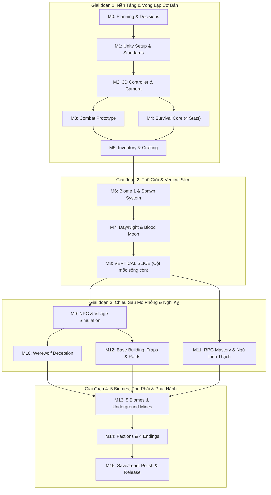

# Project Roadmap: Huyết Nguyệt Đại Ngàn

## 1. Tổng Quan Lộ Trình & Sơ Đồ Phụ Thuộc (Dependency Map)

Dự án được chia thành 16 Milestone (M0 → M15) theo 4 giai đoạn chiến lược. Quy tắc bất biến: **Hoàn thành Vertical Slice (M8) trước khi mở rộng quy mô thế giới và hệ thống nâng cao (M9 → M15).**

---

## 2. Danh Sách 16 Milestones & Deliverables

| Milestone | Tên Milestone | Trọng tâm kỹ thuật | Deliverables chính | Độ phức tạp |
| :--- | :--- | :--- | :--- | :--- |
| **M0** | Feasibility, Scope & Technical Planning | Chốt quyết định kiến trúc, lập bộ tài liệu chuẩn `docs/`. | 6 tài liệu nền tảng trong `docs/`. | Thấp (S) |
| **M1** | Environment & Unity Foundation | Khởi tạo Project Unity 6 URP, Git, `.gitignore`, Coding Standards. | Project Unity chạy không lỗi, Scene rỗng, bản build `.exe` test. | Thấp (S) |
| **M2** | 3D Character Controller & Camera | Di chuyển Isometric 3/4, Cinemachine, xoay nhân vật, animation cơ bản. | Prefab `Player`, Prefab `CameraRig`, Scene `Test_Movement`. | Vừa (M) |
| **M3** | Combat Prototype | Hitbox, `HealthComponent`, AI quái FSM cơ bản, hiệu ứng trúng đòn. | Scene `Test_CombatArena`, Unit Tests sát thương, AI Sói Bậc 1. | Vừa (M) |
| **M4** | Survival Core | 4 thanh: HP, Hunger, Stamina, Mana; chặt cây, đập đá, nhặt đồ. | `PlayerStatsComponent`, Resource Nodes (Cây/Đá), HUD 4 thanh. | Vừa (M) |
| **M5** | Inventory, Items & Crafting | Túi đồ, trang bị, công thức chế tạo, UI MVC / MVP. | Hệ thống Inventory, Item Definitions, UI Túi & Chế tạo. | Vừa (M) |
| **M6** | World Prototype & Biome 1 | Level Design Biome 1 Rừng Rậm, Làng Khai Hoang, NavMesh, đo FPS. | Scene `Biome1_JungleVillage`, Spawner tài nguyên & quái. | Vừa (M) |
| **M7** | Day/Night, Moon Cycle & Blood Moon | Đồng hồ thế giới, chu kỳ trăng, ánh sáng đêm đỏ, quái tấn công làng. | `GameTimeManager`, `MoonPhaseSystem`, `NightRaidDirector`. | Vừa (M) |
| **M8** | **Vertical Slice** | **Ghép toàn bộ M1–M7 thành game chơi được từ đầu đến cuối.** | **Bản build `VerticalSlice_v0.1.exe` hoàn chỉnh.** | **Cao (L)** |
| **M9** | NPC & Village Simulation | Lịch sinh hoạt dân làng, kho lương làng, Công Trình Sư sửa rào. | `NPCScheduleController`, `VillageManager`, NPC thợ mộc. | Cao (L) |
| **M10** | Werewolf Deception System | Thương nhân Du Mục thật/giả, bẫy hàng hóa, 3 tầng phát hiện, phạt 7 ngày. | `TraderIdentityComponent`, Đuốc Ngải Cứu, Gương Đồng, Chuông Gió. | Cao (L) |
| **M11** | RPG Progression & Mastery | Bảng thông thạo Albion (5 nhánh), 3 chuyên môn hóa, khảm Ngũ Linh Thạch. | `MasterySystem`, Cây kỹ năng vũ khí, Status Effects nguyên tố. | Cao (L) |
| **M12** | Base Building, Traps & Raids | Dựng 5 cấp tường thành, bẫy tre trúc, tháp nỏ, AI nhảy tường / phá tường. | `BuildingPlacementSystem`, Lũy Tre, Giàn Ná Lưới Bạc, Bẫy Chông. | Rất cao (XL) |
| **M13** | 5 Biomes & Underground Mines | Mở rộng 5 Biomes Việt Nam, 4 tầng hầm mỏ, Tộc Huyết Thi, 9 Bậc Sói. | Cổng chuyển vùng, 5 Scenes Biome, Boss Hầm Ngầm, Sói Vua. | Rất cao (XL) |
| **M14** | Factions & 4 Endings | Người Lùn 3 cấp, Phù Thủy, Hội Săn Sói, Hợp Thể Người-Sói, 4 Endings. | `FactionReputationSystem`, Vũ Khí Huyền Thoại, 4 kịch bản kết thúc. | Cao (L) |
| **M15** | Persistence, QA & Release | Save/Load có versioning, Object Pooling, Quality Settings, Standalone Build. | Game hoàn chỉnh, hệ thống lưu trữ toàn diện, tối ưu 60+ FPS. | Cao (L) |

---

## 3. Phân Chia Vai Trò Cho Đội Ngũ 6 Thành Viên (Team Work Breakdown)

Với đội ngũ 6 người kết hợp cùng 2 AI (GPT-6 Astra & Gemini 4 Argon), dự án được phân công trách nhiệm rõ ràng để tránh xung đột file trong Git:

| Vai trò | Phụ trách chính | Trách nhiệm cụ thể | Vùng làm việc trong Git |
| :--- | :--- | :--- | :--- |
| **1. Lead Architect / Gameplay Programmer (Bạn)** | Kiến trúc Core & Review | Quản lý kiến trúc tổng thể, tích hợp hệ thống, điều phối AI và review code của team. | `Assets/_Project/Scripts/Core/`, `docs/` |
| **2. Gameplay & Systems Programmer** | Combat & Survival | Lập trình logic di chuyển, chiến đấu, 4 thanh trạng thái, Inventory và Crafting. | `Assets/_Project/Scripts/Combat/`, `Player/`, `Inventory/` |
| **3. AI & World Programmer** | Quái vật, NPC & Hệ thống Đêm | Lập trình AI FSM Sói, lịch sinh hoạt dân làng, chu kỳ trăng, cơ chế giả dạng và AI công thành. | `Assets/_Project/Scripts/AI/`, `World/`, `Factions/` |
| **4. Technical Artist & Asset Pipeline** | Model 3D, Rigging & Animation | Chuẩn hóa model Low-Poly / Stylized, gắn xương qua Mixamo, cấu hình Animator Controller, VFX URP. | `Assets/_Project/Art/Characters/`, `Props/`, `VFX/` |
| **5. Level Designer & Environment Artist** | Dựng Scene & Modular World | Dựng địa hình 5 Biomes, bố trí làng, đặt Spawner, nướng NavMesh và cấu hình ánh sáng URP. | `Assets/_Project/Scenes/`, `Prefabs/Environment/` |
| **6. UI/UX & QA Tester** | Giao diện & Kiểm thử hệ thống | Thiết kế UI Canvas, HUD 4 thanh, bảng Inventory/Crafting, viết kịch bản test và chạy test thủ công. | `Assets/_Project/Art/UI/`, `Scripts/UI/`, `docs/qa/` |

---

## 4. Quy Tắc Bất Biến Giữa Các Milestone
1. **Definition of Done (DoD):** Mỗi task chỉ được đánh dấu là hoàn thành khi:
   * Code compile 0 lỗi trên Unity Console.
   * Chạy trực tiếp trên Scene thử nghiệm không phát sinh Exception.
   * Có Unit Test cho logic tính toán độc lập.
   * Đã cập nhật trạng thái vào `docs/handoff/CURRENT_STATE.md`.
2. **Kiểm Soát Xung Đột Scene trong Git:** Không bao giờ để 2 thành viên cùng chỉnh sửa chung một file `.unity`. Sử dụng **Prefab-based Workflow** (mỗi người làm việc trên Prefab riêng, sau đó kéo vào Scene chính).

