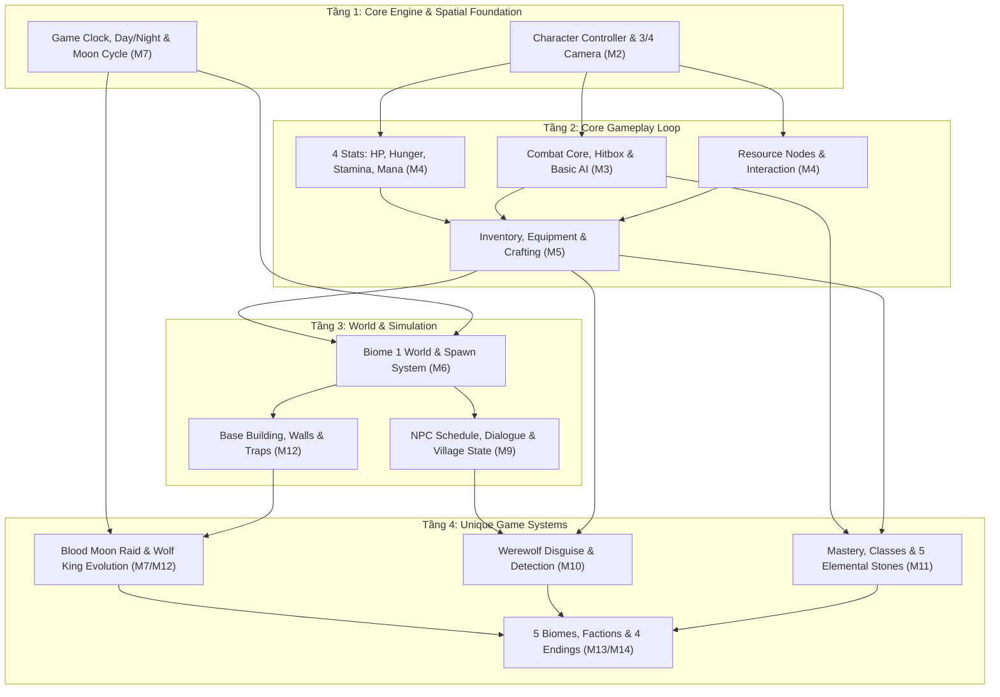
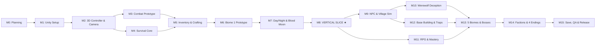
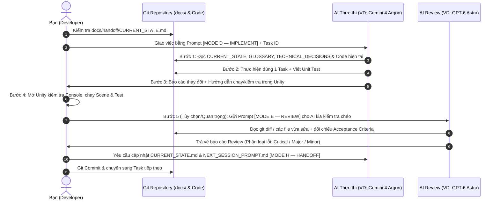

# AI-Assisted 3D Game Development Roadmap & Execution Framework
**Dự án:** Huyết Nguyệt Đại Ngàn  
**Chế độ hiện tại:** `MODE A — ROADMAP` (Phân tích GDD, đánh giá khả thi, kiến trúc nền tảng & lập kế hoạch tổng thể — **Không viết code**)  
**Tài liệu gốc đã kiểm tra:** [Cot_Truyen_Va_GDD_Huyet_Nguyet_Dai_Ngan_v3.md](file:///d:/4D1S_STARTUP_GAME_HUYETNGUYETDAINGAN/huyet-nguyet-dai-ngan/Cot_Truyen_Va_GDD_Huyet_Nguyet_Dai_Ngan_v3.md)

---

## 1. Tóm Tắt Vision & Gameplay Pillars

### 1.1. Game Vision
**Huyết Nguyệt Đại Ngàn** là tựa game **3D Stylized Isometric Survival Action RPG** kết hợp **Base Defense** và **Social Deduction** (Nghi kỵ xã hội), lấy bối cảnh vùng đất giả tưởng **Đại Ngàn Văn Lang** đậm bản sắc văn hóa, kiến trúc và truyền thuyết Việt Nam (lũy tre làng, cơ quan mộc, đúc đồng Đông Sơn, Nam Y, Ngũ Linh Thạch, tuyệt đối không có công nghệ hiện đại).

Người chơi bắt đầu là một dân làng khai hoang giữa Rừng Rậm Trường Sơn, vừa phát triển ngôi làng, rèn luyện kỹ năng, vừa đối phó với bầy Người Sói tiến hóa theo từng ngày và trà trộn vào làng dưới lốt thương nhân ban ngày, trước khi quyết định vận mệnh thế giới qua các ngả rẽ phe phái.

### 1.2. Năm Trụ Cột Gameplay (Core Gameplay Pillars)

| Trụ cột | Mô tả trải nghiệm cốt lõi | Tham chiếu GDD |
| :--- | :--- | :--- |
| **1. Sinh tồn & Khai hoang theo Chu kỳ Ngày/Đêm** | Ban ngày khai thác gỗ/đá/khoáng sản, trồng trọt, chế tác ẩm thực & Nam Y để duy trì 4 thanh trạng thái (`HP`, `Hunger`, `Stamina`, `Mana`). Ban đêm phòng thủ làng hoặc đi săn. | Mục 1.3, 2.2, 3.1, 6.1, 9.3 |
| **2. Isometric Action Combat & Albion-style Mastery** | Chiến đấu góc nhìn 3/4 với 5 nhánh binh khí cổ truyền, 3 hướng tiến hóa nghề nghiệp (`Kiếm Sĩ`, `Thợ Săn`, `Pháp Sư`), hệ thống thông thạo "Làm gì giỏi nấy" (`Mastery`) và khảm `Ngũ Linh Thạch`. | Mục 3.2, 4.1, 7.1, 9.1, 9.2 |
| **3. Nghi Kỵ Xã Hội (Werewolf Deception)** | Người Sói từ Bậc 2+ giả dạng Người Du Mục vào làng buôn bán ban ngày, bán hàng dẫn dụ hoặc chờ đêm hóa thú. Người chơi dùng vật phẩm tâm linh/thảo dược/thú cưng để vạch mặt mà không chém nhầm người thật. | Mục 4.1, 4.2, 5.1, 7.2, 9.3, 9.4 |
| **4. Xây Dựng Làng & Phòng Thủ Đêm Huyết Nguyệt** | Nâng cấp Đình Làng qua 5 cấp văn minh, dựng lũy tre, tường đá, hào chông, cơ quan tre trúc để chống lại các đợt công thành (`Blood Moon Raid`) và cơ chế nhảy tường/phá rào của Sói. | Mục 5.2, 5.4, 6.2, 8.1, 9.4 |
| **5. Tiến Hóa Hệ Sinh Thái Địch & Lựa Chọn Phe Phái** | Sói Vua mạnh dần mỗi đêm nhờ lượng thức ăn bầy sói cống nạp; Người Lùn trung lập rèn đồ cho cả hai phe; 4 kết cục (`Endings`) dựa trên việc bảo vệ Làng, hóa Sói, theo Hội Săn Sói hay theo Phù Thủy Ác. | Mục 1.2, 4.2, 4.3, 4.4, 5.3, 5.5 |

---

## 2. Sơ Đồ Các Hệ Thống Phụ Thuộc Lẫn Nhau (System Dependency Map)

Trong phát triển game, bạn không thể xây hệ thống nâng cao (như *Người Sói giả dạng thương nhân* hay *Đêm Huyết Nguyệt công thành*) khi chưa có các hệ thống nền tảng bên dưới. Sơ đồ dưới đây thể hiện thứ tự phụ thuộc bắt buộc:



### Giải thích góc nhìn từ Java Web Developer sang Game Architecture:
* **Không có Request-Response rời rạc:** Trong Spring Boot, mỗi HTTP Request có vòng đời ngắn rồi kết thúc. Trong Unity, game chạy liên tục trong một **Game Loop** (`Update` mỗi frame — 60 lần/giây, `FixedUpdate` cho vật lý). Nếu bạn đặt logic nặng (như tìm đường hay quét kho đồ) trong `Update()` của 100 đối tượng, game sẽ tụt FPS ngay lập tức.
* **Data-Driven Design (`ScriptableObject` ↔ Static Config / Read-only Entity):** Thay vì tạo bảng Database cho danh mục Vũ khí, Công thức rèn, hay 9 Bậc Sói, Unity dùng `ScriptableObject` — các file dữ liệu tĩnh nằm trong project, giúp bạn chỉnh sửa chỉ số trên giao diện Editor mà không cần sửa code C#.

---

## 3. Phân Tích Mâu Thuẫn, Điểm Thiếu Rõ Ràng & Nguy Cơ Mất Cân Bằng Trong GDD

Sau khi đối chiếu toàn bộ [Cot_Truyen_Va_GDD_Huyet_Nguyet_Dai_Ngan_v3.md](file:///d:/4D1S_STARTUP_GAME_HUYETNGUYETDAINGAN/huyet-nguyet-dai-ngan/Cot_Truyen_Va_GDD_Huyet_Nguyet_Dai_Ngan_v3.md) với định hướng 3D Isometric của bạn, có **6 vấn đề trọng yếu** cần giải quyết ngay từ khâu thiết kế kỹ thuật:

| STT | Vấn đề phát hiện trong GDD | Mâu thuẫn / Rủi ro thực tế | Giải pháp kỹ thuật & Thiết kế đề xuất |
| :--- | :--- | :--- | :--- |
| **1** | **Mâu thuẫn 2D vs 3D:** Dòng 5 và Mục 1.1 của GDD ghi *"2D Pixel Art \| Top-Down"*, trong khi định hướng mới là **3D Stylized kiểu Albion Online**. | Nhiều cơ chế trong GDD được viết theo tư duy 2D phẳng, khi lên 3D sẽ phát sinh chi phí làm model, animation, chiều cao địa hình và va chạm 3 chiều. | Chốt **3D Stylized Low/Mid-Poly với góc nhìn Isometric/3/4 cố định** (không xoay camera tự do 360 độ kiểu góc nhìn thứ 3 sau lưng) để giảm tải thiết kế môi trường và giữ đúng cảm giác Albion Online. |
| **2** | **Đào mỏ 4 tầng kiểu Minecraft (Mục 6.1) & Độn Thổ Thi đào hầm xuyên tường (Mục 8.3)** trong môi trường 3D Isometric. | Làm địa hình Voxel đào tự do mọi nơi trong 3D đòi hỏi xử lý lưới 3D động, cập nhật đường đi AI (`NavMesh`) thời gian thực và cắt lớp camera xuyên đất — quá phức tạp cho 1 người làm. | **Thay thế Voxel tự do bằng:**<br>1. **Cửa Hầm Mỏ / Hang Ngầm (Sub-scene / Instanced Underground):** Giống Albion Online, bước vào cửa mỏ sẽ chuyển xuống tầng địa chất tương ứng.<br>2. **Cơ chế Độn Thổ (Burrow State):** Quái lặn xuống mặt đất tại điểm ngoài tường (hiệu ứng đất trồi) và trồi lên bên trong làng nếu tường chưa nâng cấp nền móng, không cần biến dạng mặt đất 3D thật. |
| **3** | **Tiến hóa Sói Vua không giới hạn (Snowball vĩnh viễn) & Nguy cơ thua cuộc (Mục 3.1, 4.2, 5.2).** | Bầy sói nuôi Sói Vua tăng chỉ số vĩnh viễn mỗi đêm, cộng thêm buff `x3 HP/Stamina` khi công làng. Nếu người chơi phát triển chậm hoặc lơ là chặn đường tiếp tế, Sói Vua sẽ mạnh vượt tầm kiểm soát. | **Chốt giữ nguyên theo GDD (Hardcore Survival Fail Condition):**<br>• Cho phép Sói Vua tăng chỉ số vĩnh viễn mỗi đêm không đặt trần. Nếu người chơi phát triển chậm, Sói Vua sẽ mạnh vượt tầm kiểm soát và chiến thắng người chơi.<br>• Đây là điều kiện thua cuộc chủ ý (`Fail Condition`) để tạo áp lực sinh tồn sống còn; người chơi nhận thất bại và rút kinh nghiệm cho màn chơi sau.<br>• Người chơi phải tích cực áp dụng chiến thuật **Đánh Phủ Đầu** chặn đường Sói tha mồi về hang ban đêm để kìm hãm đà tăng trưởng của Sói Vua. |
| **4** | **Chồng chéo 6 công cụ phát hiện Sói giả dạng (Mục 2.2, 5.1, 7.2, 9.3, 9.4):** Voọc Ngũ Sắc, Chó Phú Quốc, Đuốc Ngải Cứu, Soi Hàng Hóa, Gương Đồng, Chuông Gió. | Nếu Chuông Gió hay Voọc Ngũ Sắc tự động báo động chính xác 100%, người chơi sẽ không bao giờ cần dùng Gương Đồng, đốt Ngải Cứu hay kiểm tra hàng hóa nữa. Ngoài ra GDD chưa nêu rõ **hình phạt khi giết nhầm Người Du Mục thật**. | **Phân tầng Gợi ý (Suspicion) vs Xác thực (Confirmation):**<br>• **Tầng Cảnh báo diện rộng (Chuông Gió / Thú cưng):** Chỉ báo hiệu *"Có mùi máu trong đoàn buôn"* (không chỉ đích danh ai).<br>• **Tầng Nghi vấn (Soi hàng hóa):** Phát hiện món hàng đáng ngờ.<br>• **Tầng Xác thực (Đuốc Ngải Cứu / Gương Đồng):** Tốn tài nguyên/độ bền để vạch mặt đích danh.<br>• **Hình phạt đánh nhầm:** Mất điểm Uy Tín Thương Đoàn, thương nhân bỏ chạy và **ngừng ghé làng trong 7 ngày** (khiến làng mất nguồn giao thương quan trọng). |
| **5** | **Chồng chéo hệ thống Class (Mục 4.1), Mastery Albion (Mục 7.1), 5 Nhánh Vũ Khí (Mục 9.1) và Hóa Sói (Mục 3.1).** | Mục 4.1 chia 3 Class cố định, nhưng Mục 7.1 lại theo triết lý "không bó buộc khuôn mẫu" của Albion. Đồng thời cần làm rõ vai trò của Mana và Stamina khi ở dạng Người Sói. | **Chuẩn hóa Cơ chế Mana, Hóa Sói & Albion Mastery:**<br>• **Mana khác Stamina:** Người Sói không giới hạn Stamina (hoặc hồi siêu tốc), nhưng vẫn có Mana.<br>• **Mana là Thời Gian Biến Hình:** Khi hóa Sói, Mana giảm dần theo thời gian đến khi cạn kiệt sẽ biến trở lại thành người.<br>• **Albion Equipment + Mastery:** Kỹ năng chiến đấu gắn với **Vũ khí & Giáp đang mặc**. 3 danh hiệu (`Kiếm Sĩ`, `Thợ Săn`, `Pháp Sư`) là **Chuyên môn hóa (Specialization)** mở khóa kỹ năng bậc cao.<br>• Khi người chơi ở dạng Hóa Sói, Mana đóng vai trò **Huyết Năng** để thi triển các kỹ năng đặc thù nhánh Huyết Thống. |
| **6** | **Mô phỏng AI ngoài tầm mắt người chơi:** *"Người Sói Đặc Biệt đi tìm Người Lùn rèn vũ khí"* (Mục 4.2, 5.3) & *"Sói tha mồi về hang nuôi Sói Vua"* (Mục 5.2). | Cần đảm bảo phe Sói liên tục tiến hóa mà không gây tốn tài nguyên CPU khi xử lý chuyển động 3D ngoài tầm nhìn của người chơi. | **Dùng kỹ thuật Hybrid Simulation:**<br>• **Mô phỏng toán học ngầm (`WorldEventScheduler`):** Dù ở xa, phe Sói và quái vật **vẫn không ngừng tiến hóa theo thời gian** (tích lũy thịt nuôi Sói Vua, tính toán Người Sói Đặc Biệt nhận vũ khí mới).<br>• **Cầu nối vật lý (Physical Spawn):** Chỉ khi người chơi đến gần khu vực Lò Rèn Người Lùn hoặc đường mòn về hang Sói (hoặc mua tin tình báo từ Người Lùn), hệ thống mới **Spawn thực thể 3D vật lý** với đúng trang bị/thịt để người chơi phục kích. |

---

## 4. Đánh Giá Tính Khả Thi Khi Phát Triển Solo Với AI

Phát triển một game 3D lấy cảm hứng từ *Albion Online* kết hợp *Survival Base Defense* bởi **1 lập trình viên (nền tảng Java Web) + 2 AI** là **KHẢ THI**, nhưng **chỉ khi kiểm soát chặt chẽ 4 giới hạn sau**:

1. **Độ khả thi về Lập trình (Code & Architecture) — Cao (8.5/10):**
   * Với tư duy OOP, State Management và Data Modeling từ Java, bạn sẽ tiếp cận C# trong Unity rất nhanh (C# và Java có cú pháp tương đồng trên 80%).
   * Các hệ thống như Inventory, Crafting, Mastery, Chu kỳ Trăng, Hệ thống Phe phái, Kinh tế Vùng miền thực chất là **Data-driven Logic** — thế mạnh của bạn và cũng là phần mà GPT-6 Astra / Gemini 4 Argon hỗ trợ viết code, viết Unit Test tốt nhất.
2. **Độ khả thi về Đồ họa 3D & Animation (Art & Asset Pipeline) — Thấp nếu tự vẽ, Khả thi nếu dùng Modular Assets (6/10):**
   * **Cảnh báo thực tế:** Một người không chuyên 3D Modeling/Rigging **không thể** tự nặn 10 loài thú Việt Nam, 9 bậc biến hình Người Sói, 5 cấp Huyết Thi, 3 cấp Thương Đoàn Kỵ Binh từ con số 0.
   * **Chiến lược sống còn:**
     * Giai đoạn M1–M8: Dùng **Placeholder (Primitive Meshes / Khối màu phân biệt / Asset Low-Poly miễn phí chuẩn humanoid)** kết hợp kho animation miễn phí từ **Mixamo**.
     * Tách biệt hoàn toàn **Gameplay Logic** khỏi **Visual Model** (ví dụ: trạng thái Biến hình Sói ở M10 chỉ cần đổi `VisualRoot` prefab và nhân hệ số stats, chưa cần animation biến hình phức tạp).
     * Tận dụng kỹ thuật **Scale + Material Tint + VFX/Aura + Modular Attachment** (ví dụ: Sói Bậc 1, Bậc 2, Bậc 4, Bậc 7 có thể dùng chung 1 khung xương Sói cơ bản nhưng thay đổi kích thước, màu lông, giáp gắn thêm và hiệu ứng Lửa/Băng/Sương mù).
3. **Độ khả thi về Quy mô Thế giới (World Scale) — Trung bình (7/10):**
   * Không làm thế giới mở liền mạch khổng lồ (Seamless Open World) ngay từ đầu. Hãy chia bản đồ thành **các Zone kết nối qua cổng chuyển vùng (Zone Portals / Scene Additive Loading)** giống hệt cách **Albion Online** chia các vùng bản đồ (Cluster/Zone). Cách này vừa đúng chất Albion, vừa dễ quản lý bộ nhớ, vừa giúp bạn làm hoàn chỉnh từng Biome một.
4. **Độ khả thi về AI/NPC Simulation — Trung bình (7/10):**
   * Giới hạn số lượng NPC dân làng hoạt động thực tế trong làng ở mức **5–12 NPC** (thay vì hàng trăm người), mỗi NPC đại diện rõ rệt cho một vai trò (Trưởng Làng, Thợ Mộc, Thợ Rèn, Tuần Phiên...).

---

## 5. Đề Xuất Engine & Technical Stack (So Sánh Unity vs Unreal Engine)

### 5.1. Đánh giá Unity vs Unreal Engine 5 cho dự án này

| Tiêu chí | Unity (Đề xuất chọn) | Unreal Engine 5 |
| :--- | :--- | :--- |
| **Ngôn ngữ lập trình & Đường cong học tập** | **C#** — Cú pháp, OOP, Generic, Collection, Interface cực kỳ gần gũi với **Java Developer**. Thời gian làm quen chỉ mất 1–2 tuần. | **C++ / Blueprints** — C++ quản lý bộ nhớ phức tạp, thời gian compile lâu; Blueprints là kéo thả dạng node khó diff/review bằng AI qua Git. |
| **Khả năng phối hợp với AI (Astra & Argon)** | **Rất cao:** Code C# dạng text thuần túy và file cấu trúc rõ ràng, AI dễ đọc, sinh code, viết Unit Test và review chính xác. | **Thấp hơn với Blueprint:** AI không thể chỉnh sửa trực tiếp file nhị phân `.uasset` của Blueprint một cách an toàn. |
| **Phong cách đồ họa Stylized Isometric (kiểu Albion)** | **Rất phù hợp:** Thực tế **chính Albion Online được phát triển bằng Unity**! Pipeline URP hỗ trợ đồ họa Stylized 3D nhẹ, rõ nét và tối ưu tốt. | Thế mạnh nghiêng về đồ họa Photorealistic (Lumen/Nanite), khá nặng cho góc nhìn Isometric nhiều đơn vị. |
| **Yêu cầu phần cứng phát triển** | Nhẹ hơn đáng kể, khởi động nhanh, chiếm ít RAM/VRAM và dung lượng ổ cứng. | Đòi hỏi cấu hình PC rất cao (RAM 32GB+, SSD dung lượng lớn, GPU mạnh). |
| **Kho tài nguyên & Cộng đồng Top-Down/RPG** | Rất phong phú cho dòng game Isometric RPG, Survival, Low-poly Stylized. | Nhiều asset thiên về tả thực (Realistic). |

### 5.2. Chốt Technical Stack Đề Xuất

* **Game Engine:** **Unity 6 LTS (6000.0.x LTS)** hoặc **Unity 2022.3 LTS** (ưu tiên bản LTS ổn định).
* **Rendering Pipeline:** **Universal Render Pipeline (URP)** — chuẩn mực cho đồ họa 3D Stylized góc nhìn 3/4, hỗ trợ tốt ánh sáng Ngày/Đêm, sương mù Đầm Lầy và hiệu ứng Đá Nguyên Tố với chi phí hiệu năng thấp.
* **Ngôn ngữ & IDE:** **C# (.NET Standard 2.1)** cùng **JetBrains Rider** (rất giống IntelliJ IDEA mà dân Java quen thuộc) hoặc **Visual Studio 2022 / VS Code**.
* **Input System:** **Unity Input System Package (New Input System)** — dùng 1 phương án duy nhất dựa trên `InputActionAsset`, tuyệt đối không trộn lẫn `UnityEngine.Input` cũ.
* **Camera System:** **Unity Cinemachine** — cấu hình góc nhìn Isometric / Top-Down 3/4 ổn định, hỗ trợ chống rung và giới hạn vùng nhìn.
* **Navigation / Pathfinding:** **Unity AI Navigation (`NavMeshSurface`)** — tích hợp sẵn, đủ dùng cho quái vật tuần tra, NPC đi lại và công thành cơ bản.
* **UI Framework:** **TextMeshPro + Unity UI (uGUI)** — trực quan, dễ học cho người mới, dễ debug trên Scene và tương thích mọi tài liệu hướng dẫn.
* **Data & Persistence:**
  * Cấu hình tĩnh (Item, Recipe, Enemy Stats, Biome Config): **`ScriptableObject`**.
  * Lưu trữ trạng thái (Save/Load): **Local JSON Serialization** (dễ đọc, dễ debug như JSON trong REST API).
* **Testing:** **Unity Test Framework (NUnit)** — tách riêng `EditMode Tests` (test logic thuần C# chạy nhanh như JUnit) và `PlayMode Tests` (test tương tác trong Scene).
* **Version Control:** **Git + `.gitignore` chuẩn Unity** (kết hợp Git LFS khi bắt đầu đưa asset 3D lớn vào).

---

## 6. Đề Xuất Phạm Vi MVP & Vertical Slice (M8)

Để không bị ngợp bởi hàng chục hệ thống trong GDD, mục tiêu đầu tiên của dự án là đạt được **Vertical Slice (Milestone 8)** — một bản game thu nhỏ nhưng có **vòng lặp hoàn chỉnh từ sáng đến đêm**:

### 6.1. Những gì CÓ trong MVP / Vertical Slice (M0 → M8)
* **Bối cảnh:** 1 khu vực nhỏ thuộc **Biome 1 (Rừng Rậm Trường Sơn)** gồm bìa rừng và **Làng Khai Hoang**.
* **Nhân vật & Chỉ số:** Di chuyển 3D góc nhìn 3/4, 4 thanh trạng thái (`HP`, `Hunger`, `Stamina`, `Mana`), ăn uống, tiêu hao thể lực.
* **Chiến đấu cơ bản:** 1 vũ khí cận chiến (`Trường Kiếm Sắt Ấp Làng` hoặc `Mã Tấu Đi Rừng`), đánh thường, lăn né, hitbox, sát thương.
* **Kẻ địch:** 1 loài thú rừng (`Lợn Rừng`) và 1 loại Người Sói (`Sói Bậc 1 - Huyết Lang Sơ Khởi`) có AI tuần tra, phát hiện, truy đuổi, tấn công.
* **Khai thác & Chế tạo:** Chặt cây lấy Gỗ, đập đá lấy Đá Cuội, hái quả/nấm; mở túi đồ (`Inventory`), trang bị vũ khí, chế tạo vật phẩm cơ bản (`Cơm Lam`, `Đuốc`, `Rìu`).
* **Chu kỳ thời gian & Sự kiện đêm:** Đồng hồ Ngày/Đêm, ánh sáng thay đổi theo giờ, Chu kỳ Trăng rút gọn để test và 1 đợt **Blood Moon Raid** cơ bản tấn công làng vào ban đêm.
* **NPC & Nhiệm vụ cơ bản:** 1 NPC **Trưởng Làng** giao nhiệm vụ chuẩn bị phòng thủ đêm trăng máu và trao thưởng khi sống sót.
* **Lưu game cơ bản:** Lưu và tải lại vị trí, máu, túi đồ và ngày hiện tại.

### 6.2. Những tính năng BẮT BUỘC HOÃN đến sau Vertical Slice (M9 → M15)

| Tính năng trong GDD | Hoãn đến Milestone | Lý do kỹ thuật phải hoãn |
| :--- | :--- | :--- |
| Lịch sinh hoạt NPC dân làng, NPC tự đi thu thập gỗ & nâng cấp làng | **M9** | Cần hệ thống World, Time và Resource ổn định trước khi cho AI tự động tương tác. |
| Người Sói giả dạng Người Du Mục & công cụ phát hiện (Ngải Cứu, Gương Đồng, Voọc) | **M10** | Cần hệ thống NPC, Giao dịch và Ngày/Đêm chạy chuẩn trước. |
| 3 Nhánh nghề nghiệp, 5 Nhánh Mastery Albion, 5 Đá Nguyên Tố & Hợp Thể | **M11** | Tránh làm phức tạp công thức sát thương khi Combat cơ bản chưa cân bằng. |
| Xây dựng tường 5 cấp, Bẫy tre trúc, Tháp phòng thủ & AI công thành phá tường | **M12** | AI tìm đường công thành (`Siege Pathfinding`) rất dễ lỗi nếu làm quá sớm. |
| 4 Biomes còn lại (Đầm Lầy, Sa Mạc, Hang Động, Núi Tuyết), 9 Bậc Sói, Sói Vua, Tộc Huyết Thi | **M13** | Chỉ nhân rộng nội dung sau khi cấu trúc Biome 1 đã hoàn chỉnh. |
| Hệ thống Phe phái (Người Lùn 3 cấp, Phù Thủy Tốt/Ác, Hội Săn Sói, Thương Hội) & 4 Endings | **M14** | Đòi hỏi toàn bộ thế giới và cốt truyện các hồi trước đã sẵn sàng. |

---

## 7. Roadmap Chi Tiết: Milestone, Task, Dependency, Deliverables & Điều Kiện Chuyển Tiếp

> **Quy ước ước lượng độ phức tạp:**
> * **Độ phức tạp:** `Thấp (S)`, `Trung bình (M)`, `Cao (L)`, `Rất cao (XL)`.
> * **Giả định:** Bạn làm việc độc lập với sự hỗ trợ của GPT-6 Astra và Gemini 4 Argon, vừa học khái niệm Unity vừa thực hành từng bước. Không quy đổi thành ngày cố định khi chưa biết số giờ rảnh mỗi tuần của bạn.

### Tổng quan Lộ trình 16 Milestones (M0 → M15)



---

### GIAI ĐOẠN 1: NỀN TẢNG & CƠ CHẾ CỐT LÕI (M0 → M5)

#### **M0 — Feasibility, Scope & Technical Planning** *(Độ phức tạp: S)*
* **Mục tiêu:** Chốt toàn bộ quyết định kỹ thuật, giải quyết các mâu thuẫn trong GDD và khởi tạo bộ tài liệu chuẩn trong repository để hai AI cùng tham chiếu.
* **Dependency:** Không có (Milestone khởi đầu).
* **Task & Subtask chính:**
  * `M0-T1`: Khởi tạo cấu trúc thư mục `docs/` theo chuẩn dự án.
  * `M0-T2`: Viết `PROJECT_ROADMAP.md` và `MVP_SCOPE.md` (chốt ranh giới Vertical Slice M8).
  * `M0-T3`: Viết `TECHNICAL_DECISIONS.md` (chốt Unity LTS, URP, Input System, 3D Zone-based world thay vì Voxel).
  * `M0-T4`: Viết `RISK_REGISTER.md` và `GLOSSARY.md` (bảng ánh xạ thuật ngữ GDD tiếng Việt ↔ tên class/enum tiếng Anh trong code, ví dụ: `Ngũ Linh Thạch` ↔ `ElementalStoneType`, `Sói Vua` ↔ `WolfKing`).
* **Deliverables:** 5 file tài liệu nền tảng trong `docs/`.
* **Acceptance Criteria:**
  * [ ] Mọi mâu thuẫn trong GDD (2D vs 3D, đào mỏ 4 tầng, 6 cách phát hiện Sói, Sói Vua snowball) đều có quyết định xử lý rõ ràng bằng văn bản.
  * [ ] Có bảng `GLOSSARY.md` thống nhất tên gọi để Astra và Argon không đặt tên class lệch nhau.
* **Rủi ro:** Thay đổi quyết định công nghệ liên tục về sau.
* **Điều kiện chuyển sang M1:** Bạn xác nhận duyệt các quyết định kỹ thuật ở cuối tài liệu này và commit bộ `docs/` M0 vào Git.

---

#### **M1 — Development Environment & Unity Foundation** *(Độ phức tạp: S)*
* **Mục tiêu:** Cài đặt Unity, IDE, tạo project chuẩn URP, thiết lập cấu trúc thư mục, Git workflow và chạy thử bản build rỗng đầu tiên.
* **Kiến thức cần học (Java ↔ Unity):**
  * Cấu trúc thư mục Unity (`Assets/`, `Packages/`, `ProjectSettings/`, thư mục `Library/` tương tự `target/` hoặc `node_modules/` không được đẩy lên Git).
  * Khái niệm `Scene`, `GameObject`, `Component` (`MonoBehaviour`) và `Prefab` (tương tự Class Template + Instance được đóng gói sẵn).
* **Dependency:** `M0`.
* **Task & Subtask chính:**
  * `M1-T1`: Cài đặt Unity Hub, Unity LTS (URP 3D Template) và IDE (Rider/VS 2022).
  * `M1-T2`: Cấu hình `.gitignore` và `.gitattributes` chuẩn cho Unity.
  * `M1-T3`: Tạo cấu trúc thư mục trong `Assets/_Project/` (tách riêng code/asset của dự án khỏi thư mục plugin bên thứ ba).
  * `M1-T4`: Cài đặt và xác minh các package cốt lõi: `Input System`, `Cinemachine`, `AI Navigation`, `Test Framework`.
  * `M1-T5`: Tạo scene `Sandbox_Foundation.unity` có mặt phẳng Ground, Directional Light và Camera; build thử ra file `.exe` chạy độc lập.
* **Deliverables:** Unity Project mở không lỗi, `CODING_STANDARDS.md`, file build `.exe` thử nghiệm đầu tiên.
* **Acceptance Criteria:**
  * [ ] Mở project trong Unity Editor không có bất kỳ lỗi đỏ nào trên Console.
  * [ ] `git status` không theo dõi các thư mục tạm (`Library/`, `Temp/`, `Logs/`, `Obj/`).
  * [ ] Chạy lệnh Build Windows thành công và mở được cửa sổ game độc lập.
* **Rủi ro:** Commit nhầm thư mục `Library/` lên Git làm nặng repo hàng GB.
* **Điều kiện chuyển sang M2:** Build độc lập chạy thành công và cấu trúc thư mục được commit sạch sẽ.

---

#### **M2 — 3D Character Controller & Isometric Camera** *(Độ phức tạp: M)*
* **Mục tiêu:** Điều khiển nhân vật 3D di chuyển mượt mà dưới góc nhìn Isometric / 3/4 kiểu Albion Online, xoay mặt đúng hướng và không xuyên vật cản.
* **Kiến thức cần học:**
  * Hệ trục tọa độ 3D trong Unity (`X`, `Y` là chiều cao, `Z` là chiều sâu — quy tắc bàn tay trái).
  * Sự khác biệt giữa `Update()` (xử lý input, hiển thị) và `FixedUpdate()` (xử lý vật lý).
  * `CharacterController` vs `Rigidbody`, `Collider` và `Animator Controller` cơ bản (State `Idle` ↔ `Move`).
* **Dependency:** `M1`.
* **Task & Subtask chính:**
  * `M2-T1`: Thiết lập `GameInputActions` (WASD di chuyển, phím Shift chạy nhanh/lăn né, chuột xác định hướng nhìn/tấn công).
  * `M2-T2`: Thiết lập `CinemachineCamera` ở góc nhìn Isometric/3/4 (nghiêng $45^\circ - 55^\circ$ từ trên xuống) đi theo nhân vật mượt mà.
  * `M2-T3`: Viết `PlayerMovementController` chuyển đổi vector Input 2D sang hệ trục nghiêng của Camera (Camera-relative movement) để bấm lên là đi lên theo góc màn hình.
  * `M2-T4`: Xử lý xoay nhân vật theo hướng di chuyển và hướng con trỏ chuột (phục vụ định hướng đòn đánh kiểu Albion).
  * `M2-T5`: Thiết lập địa hình thử nghiệm (dốc nghiêng, bậc thang thấp, chướng ngại vật tường/đá) và gắn Animator cơ bản (`Idle`, `Walk`, `Run`).
* **Deliverables:** Prefab `Player`, Prefab `IsometricCameraRig`, Scene `Test_Movement.unity`.
* **Acceptance Criteria:**
  * [ ] Nhân vật di chuyển đúng 8 hướng theo góc nhìn camera, tốc độ đường chéo không bị nhanh hơn đi thẳng (đã normalize vector).
  * [ ] Nhân vật bước lên được dốc $\le 45^\circ$, bị chặn bởi tường/đá, không bị rung giật camera hay rơi xuyên sàn.
  * [ ] Animation chuyển trạng thái mượt giữa đứng yên và chạy.
* **Rủi ro:** Di chuyển bị lệch trục do chưa quy đổi từ hệ tọa độ màn hình sang hệ tọa độ nghiêng của camera Isometric.
* **Điều kiện chuyển sang M3/M4:** Hoàn thành kiểm thử di chuyển trên địa hình dốc và vật cản không có bug vật lý.

---

#### **M3 — Combat Prototype** *(Độ phức tạp: M)*
* **Mục tiêu:** Xây dựng vòng lặp chiến đấu cận chiến 3D cốt lõi giữa Người chơi và 1 loại quái vật (Sói Bậc 1 prototype) trong đấu trường thử nghiệm.
* **Kiến thức cần học:**
  * Giao tiếp giữa các Component thông qua C# `event` / `Action` và Interface (`IDamageable`) — tương tự thiết kế鬆 coupling (Loose Coupling) trong Java.
  * Kiểm tra vùng va chạm đòn đánh bằng `Physics.OverlapSphereNonAlloc` / `OverlapBox` thay vì dùng trigger phức tạp.
  * Máy trạng thái hữu hạn (`Finite State Machine - FSM`) cơ bản kết hợp `NavMeshAgent` cho AI quái vật.
* **Dependency:** `M2`.
* **Task & Subtask chính:**
  * `M3-T1`: Xây dựng `HealthComponent` và interface `IDamageable` (dùng chung cho cả Player, Quái vật và Công trình về sau) + Unit Test cho logic trừ máu/giáp/chết.
  * `M3-T2`: Tạo `WeaponDataSO` (`ScriptableObject`) định nghĩa sát thương, tầm đánh, thời gian hồi đòn (`Cooldown`) cho vũ khí cận chiến đầu tiên.
  * `M3-T3`: Viết `PlayerCombatController` xử lý input tấn công, xoay người theo hướng đánh, kích hoạt vùng kiểm tra trúng đòn (`Hitbox`) và tính sát thương.
  * `M3-T4`: Xây dựng AI quái vật cơ bản (`EnemyStateMachine` + `NavMeshAgent`) gồm 5 trạng thái: `Patrol` (Tuần tra) $\to$ `Detect` (Phát hiện) $\to$ `Chase` (Truy đuổi) $\to$ `Attack` (Tấn công) $\to$ `Return` (Quay về vị trí gốc khi người chơi chạy xa).
  * `M3-T5`: Thêm phản hồi chiến đấu (thanh máu trên đầu, nhấp nháy màu khi trúng đòn, đẩy lùi nhẹ, xử lý chết và Respawn trong phòng test).
* **Deliverables:** Scene `Test_CombatArena.unity`, các script `HealthComponent`, `PlayerCombatController`, `EnemyBrain`, bộ EditMode Unit Tests cho `HealthComponent`.
* **Acceptance Criteria:**
  * [ ] Người chơi vung vũ khí gây sát thương đúng tầm và góc đánh, tuân thủ thời gian `Cooldown`.
  * [ ] Quái vật tự tuần tra, phát hiện người chơi trong bán kính thiết lập, đuổi theo, dừng ở tầm đánh để ra đòn, và tự quay về khi người chơi thoát khỏi vùng truy đuổi.
  * [ ] Khi máu về `0`, thực thể chuyển sang trạng thái chết, ngừng nhận sát thương và không gây lỗi `NullReferenceException`.
* **Rủi ro:** Đòn đánh trúng nhiều lần trong cùng 1 nhát chém hoặc quái vật đẩy người chơi trượt đi do xung đột vật lý giữa `NavMeshAgent` và `CharacterController`.
* **Điều kiện chuyển sang M4/M5:** Pass toàn bộ Unit Test máu/sát thương và đánh thắng/thua quái vật ổn định trong đấu trường test.

---

#### **M4 — Survival Core (4 Thanh Trạng Thái & Khai Thác Tài Nguyên)** *(Độ phức tạp: M)*
* **Mục tiêu:** Triển khai 4 thanh trạng thái sinh tồn (`HP`, `Hunger`, `Stamina`, `Mana`) đúng quy tắc Mục 3.1 GDD và cơ chế chặt cây, đập đá, nhặt tài nguyên.
* **Kiến thức cần học:**
  * Tách biệt dữ liệu cấu hình (`SurvivalConfigSO`) khỏi logic chạy thời gian thực để dễ cân bằng game mà không hard-code.
  * Hệ thống tương tác (`IInteractable`, `IHarvestable`) cho các đối tượng môi trường.
* **Dependency:** `M2` (có thể làm song song hoặc ngay sau `M3`).
* **Task & Subtask chính:**
  * `M4-T1`: Xây dựng `PlayerStatsComponent` quản lý `HP`, `Hunger`, `Stamina`, `Mana` cùng `SurvivalConfigSO`.
  * `M4-T2`: Lập trình quy tắc sinh tồn Mục 3.1 GDD:
    * `Hunger` giảm dần theo thời gian; khi `> 80%` tự hồi nhẹ `HP`; khi `= 0%` rút `HP` theo giây.
    * `Stamina` tiêu hao khi chạy nhanh, lăn né, vung vũ khí, chặt cây, đập đá; tự hồi khi đứng yên/đi bộ.
    * `Mana` tiêu hao khi dùng kỹ năng và hồi tự nhiên theo tốc độ cấu hình.
  * `M4-T3`: Xây dựng `ResourceNode` (Cây gỗ, Tảng đá, Bụi thảo mộc) có độ bền khai thác, trạng thái cạn kiệt (`Depleted`) và hẹn giờ mọc lại (`Respawn Timer`).
  * `M4-T4`: Tạo vật phẩm rơi ra mặt đất (`WorldItemPickup`) và giao diện HUD hiển thị 4 thanh trạng thái.
* **Deliverables:** Hệ thống 4 thanh trạng thái, Prefab Cây/Đá/Bụi cây khai thác được, HUD 4 thanh chỉ số, Unit Tests cho quy tắc tiêu hao/hồi phục.
* **Acceptance Criteria:**
  * [ ] Khi hết `Stamina`, người chơi không thể chạy nước rút hoặc chặt cây cho đến khi hồi đủ mức tối thiểu.
  * [ ] Khi `Hunger > 80%`, `HP` tăng dần đến đầy; khi `Hunger = 0%`, `HP` giảm dần cho đến khi chết.
  * [ ] Chặt đổ cây hoặc đập vỡ đá sinh ra tài nguyên, chuyển sang trạng thái gốc cây/mỏ trống và tự mọc lại sau thời gian cấu hình.
* **Rủi ro:** Đặt thông số tiêu hao quá nhanh khiến người chơi chỉ chạy vài bước đã đói hoặc hết sạch thể lực.
* **Điều kiện chuyển sang M5:** 4 thanh trạng thái và cơ chế khai thác hoạt động chính xác, toàn bộ thông số nằm trong `ScriptableObject`.

---

#### **M5 — Inventory, Items & Crafting** *(Độ phức tạp: M)*
* **Mục tiêu:** Xây dựng hệ thống vật phẩm, túi đồ, sử dụng đồ ăn/dược liệu, trang bị vũ khí/giáp và chế tạo (`Crafting`) theo công thức.
* **Kiến thức cần học:**
  * Mô hình MVC / MVP nhẹ trong Unity UI: Tách lớp dữ liệu thuần C# (`InventoryModel` — giống POJO/Service trong Java, rất dễ viết Unit Test) khỏi lớp hiển thị (`InventoryUIView` — `MonoBehaviour`).
* **Dependency:** `M3`, `M4`.
* **Task & Subtask chính:**
  * `M5-T1`: Thiết kế `ItemDefinitionSO` (ID, Tên, Phân loại: `Resource`, `Consumable`, `Equipment`, `Relic`, giới hạn cộng dồn `MaxStack`, chỉ số hiệu ứng).
  * `M5-T2`: Xây dựng `InventorySystem` (thêm, bớt, gộp stack, tách stack, kiểm tra đầy túi, vứt đồ ra đất) kèm bộ Unit Test đầy đủ.
  * `M5-T3`: Xây dựng `EquipmentSystem` (các ô Vũ khí, Giáp, Cổ vật) cập nhật trực tiếp chỉ số cho `PlayerStatsComponent` và `PlayerCombatController`.
  * `M5-T4`: Xây dựng `CraftingSystem` và `CraftingRecipeSO` (kiểm tra nguyên liệu đầu vào $\to$ trừ nguyên liệu $\to$ tạo vật phẩm đầu ra, ví dụ: Gỗ + Đá $\to$ Rìu Đá; Gạo + Ống Nứa $\to$ Cơm Lam).
  * `M5-T5`: Thiết kế UI Túi đồ, Trang bị và Bảng Chế tạo; kết nối thao tác ăn `Cơm Lam` hồi `Hunger` và cầm vũ khí thay đổi sát thương.
* **Deliverables:** Hệ thống Inventory + Equipment + Crafting, bộ `ScriptableObject` vật phẩm cơ bản Việt Nam, UI đóng/mở được, Unit Tests cho Inventory & Crafting.
* **Acceptance Criteria:**
  * [ ] Nhặt vật phẩm ngoài đất tự động gộp vào ô cùng loại (nếu chưa chạm `MaxStack`) hoặc vào ô trống tiếp theo; nếu túi đầy thì không làm mất vật phẩm ngoài đất.
  * [ ] Sử dụng vật phẩm tiêu hao (`Cơm Lam`, `Đan Dược`) hồi đúng chỉ số `Hunger`/`HP` và trừ số lượng `1`.
  * [ ] Chế tạo thành công khi đủ nguyên liệu và báo lỗi rõ ràng khi thiếu nguyên liệu hoặc đầy túi.
* **Rủi ro:** Viết trực tiếp logic cộng trừ số lượng item nằm lẫn bên trong code UI Button khiến dữ liệu lệch với thực tế.
* **Điều kiện chuyển sang M6:** Pass 100% Unit Tests của Inventory/Crafting và thao tác mượt trên UI.

---

### GIAI ĐOẠN 2: THẾ GIỚI, CHU KỲ TRĂNG MÁU & VERTICAL SLICE (M6 → M8)

#### **M6 — World Prototype & Biome 1 (Rừng Rậm Trường Sơn)** *(Độ phức tạp: M)*
* **Mục tiêu:** Dựng bản đồ thử nghiệm đầu tiên của **Biome 1 (Rừng Rậm Trường Sơn)** gồm khu vực Làng Khai Hoang và rừng xung quanh, tích hợp tài nguyên, quái vật và kiểm tra hiệu năng.
* **Kiến thức cần học:**
  * Thiết kế Level bằng Modular Prefabs, `NavMeshSurface` baking trên địa hình rộng, `Occlusion Culling` và cách đọc bảng `Unity Profiler` để đo FPS / Draw Calls.
* **Dependency:** `M5`.
* **Task & Subtask chính:**
  * `M6-T1`: Quy hoạch bố cục Biome 1 nhỏ gọn: Trung tâm là Làng Khai Hoang (Đình Làng, Kho, Cổng Làng), xung quanh là Rừng Tre, Suối cạn và Bìa Rừng Sâu.
  * `M6-T2`: Đặt các cụm `ResourceNode` (Cây gỗ, Bụi tre, Mỏ đá bề mặt, Thảo dược) và `Spawner` cho thú rừng / Sói Bậc 1.
  * `M6-T3`: Bake `NavMesh` cho toàn bộ khu vực để đảm bảo AI di chuyển qua cầu, cổng làng và đường mòn không bị kẹt.
  * `M6-T4`: Thiết lập ánh sáng môi trường ban đầu, sương mù nhẹ và đo đạc FPS bằng `Profiler`.
* **Deliverables:** Scene `Biome1_JungleVillage.unity`, hệ thống `EntitySpawner`, báo cáo đo hiệu năng cơ bản.
* **Acceptance Criteria:**
  * [ ] Người chơi có thể đi từ Làng ra Rừng khai thác tài nguyên, đánh quái và quay về Làng liền mạch.
  * [ ] Quái vật và thú rừng di chuyển trên địa hình rừng không bị kẹt vào gốc cây hay tảng đá.
  * [ ] Tốc độ khung hình ổn định (đạt $\ge 60\text{ FPS}$ trên máy phát triển ở độ phân giải Full HD).
* **Rủi ro:** Đặt quá nhiều cây cối có Collider phức tạp (`MeshCollider`) hoặc bóng đổ thời gian thực gây tụt FPS.
* **Điều kiện chuyển sang M7:** Scene Biome 1 hoạt động ổn định, đường đi `NavMesh` thông suốt.

---

#### **M7 — Day/Night, Moon Cycle & Blood Moon** *(Độ phức tạp: M)*
* **Mục tiêu:** Xây dựng đồng hồ thế giới, chuyển đổi Ngày/Đêm, Chu kỳ Trăng (Khuyết $\to$ Bán Nguyệt $\to$ Tròn $\to$ Huyết Nguyệt) và kích hoạt đợt tấn công làng vào đêm Huyết Nguyệt.
* **Kiến thức cần học:**
  * Quản lý thời gian trong game (`GameTimeManager`) tách biệt với thời gian thực (`Time.deltaTime` nhân hệ số tốc độ ngày), điều khiển `Directional Light` theo đường cong (`AnimationCurve` / `Gradient`), và kiến trúc `Event-driven` phát thông báo khi đổi buổi/đổi pha trăng.
* **Dependency:** `M6`.
* **Task & Subtask chính:**
  * `M7-T1`: Xây dựng `GameTimeManager` quản lý Giờ, Ngày, Buổi (`Day` / `Dusk` / `Night` / `Dawn`) và hỗ trợ tua nhanh thời gian trong chế độ Debug để dễ test.
  * `M7-T2`: Xây dựng `MoonPhaseSystem` theo Mục 5.2 GDD: Chu kỳ Trăng Khuyết (-10% sức mạnh Sói), Bán Nguyệt (chuẩn), Trăng Tròn (+25% tốc độ Sói), và **Đêm Huyết Nguyệt** (cấu hình được chu kỳ ngày để test nhanh).
  * `M7-T3`: Đồng bộ ánh sáng mặt trời/mặt trăng và màu bầu trời/ánh sáng đỏ rực vào đêm Huyết Nguyệt.
  * `M7-T4`: Xây dựng `NightRaidDirector` — vào ban đêm thường thì sinh Sói Bậc 1 đi săn lẻ tẻ ngoài rừng; vào đêm Huyết Nguyệt thì sinh đợt Sói tiến thẳng về phía Làng và kết thúc sự kiện khi người chơi tiêu diệt hết đợt quái hoặc trời sáng.
* **Deliverables:** `GameTimeManager`, `MoonPhaseSystem`, `NightRaidDirector`, UI đồng hồ & biểu tượng Pha Trăng trên màn hình.
* **Acceptance Criteria:**
  * [ ] Ánh sáng và trạng thái ngày/đêm chuyển đổi mượt mà; Sói Bậc 1 chỉ xuất hiện/tăng hoạt động vào ban đêm.
  * [ ] Hệ thống áp dụng đúng hệ số buff/debuff cho Sói theo từng Pha Trăng.
  * [ ] Khi đến đêm Huyết Nguyệt, giao diện cảnh báo hiện lên, đợt Sói công làng được sinh ra đúng kịch bản và tự kết thúc/dọn dẹp trạng thái khi hoàn tất hoặc khi trời sáng.
* **Rủi ro:** Sự kiện đêm Huyết Nguyệt bị kẹt không kết thúc nếu 1 con Sói bị kẹt ở góc bản đồ hoặc khi người chơi pause/load game giữa đêm.
* **Điều kiện chuyển sang M8:** Chu kỳ Ngày/Đêm và sự kiện Blood Moon chạy qua nhiều ngày liên tiếp không phát sinh lỗi trạng thái.

---

#### **M8 — Vertical Slice (Cột Mốc Bắt Buộc Trước Khi Mở Rộng)** *(Độ phức tạp: L)*
* **Mục tiêu:** Ghép toàn bộ các hệ thống từ M1 đến M7 thành một vòng lặp trò chơi hoàn chỉnh từ lúc bấm "Bắt đầu" trên Main Menu cho đến khi bảo vệ thành công ngôi làng qua Đêm Huyết Nguyệt đầu tiên.
* **Dependency:** `M1` $\to$ `M7`.
* **Task & Subtask chính:**
  * `M8-T1`: Tạo NPC **Trưởng Làng** với hộp thoại đơn giản và chuỗi 3 nhiệm vụ hướng dẫn: (1) Khai thác gỗ/đá & rèn vũ khí/nấu Cơm Lam $\to$ (2) Săn Sói Bậc 1 ban đêm $\to$ (3) Sống sót và bảo vệ Đình Làng qua Đêm Huyết Nguyệt.
  * `M8-T2`: Tạo màn hình `MainMenu`, `PauseMenu`, màn hình `Victory` (Hoàn thành bản chơi thử) và `GameOver` (Khi người chơi chết hoặc Đình Làng sập).
  * `M8-T3`: Triển khai hệ thống `SaveLoadService` tối thiểu (lưu/tải JSON cho vị trí nhân vật, 4 thanh chỉ số, túi đồ, ngày giờ hiện tại và tiến độ nhiệm vụ).
  * `M8-T4`: Đóng gói bản Build độc lập và chơi thử từ đầu đến cuối không mở Unity Editor.
* **Deliverables:** Bản build `VerticalSlice_v0.1.exe` chơi được trọn vẹn từ đầu đến cuối.
* **Acceptance Criteria:**
  * [ ] Người chơi khởi động từ Main Menu, nhận nhiệm vụ từ Trưởng Làng, chặt cây, đập đá, chế tạo đồ ăn/vũ khí, chiến đấu, lưu game, tải lại game và vượt qua đợt tấn công Đêm Huyết Nguyệt mà không cần can thiệp trong Editor.
  * [ ] Không có lỗi crash hoặc kẹt tiến trình nhiệm vụ trong suốt 1 vòng chơi hoàn chỉnh.
* **Rủi ro:** Các hệ thống đơn lẻ chạy tốt nhưng khi ghép chung lại xung đột trạng thái (ví dụ: mở UI túi đồ nhưng chuột vẫn chém vũ khí, hoặc load game làm lệch giờ Ngày/Đêm).
* **Điều kiện chuyển sang M9 (Cổng kiểm duyệt cứng):** **Bắt buộc hoàn thành và nghiệm thu Vertical Slice M8 trước khi viết bất kỳ dòng code nào của M9–M15.**

---

### GIAI ĐOẠN 3: MÔ PHỎNG LÀNG, NGHI KỴ NGƯỜI SÓI & CHIỀU SÂU RPG (M9 → M12)

#### **M9 — NPC & Village Simulation** *(Độ phức tạp: L)*
* **Mục tiêu:** Biến ngôi làng thành một thực thể sống động với 4–6 NPC dân làng có lịch sinh hoạt Ngày/Đêm, kho tài nguyên chung của làng và cơ chế nâng cấp Đình Làng.
* **Dependency:** `M8`.
* **Task chính:**
  * `M9-T1`: Xây dựng `NPCDataSO` và `NPCScheduleController` (Ban ngày đi làm tại điểm khai thác/ruộng lúa/xưởng mộc; chiều tối về nhà nghỉ ngơi hoặc đứng gác cổng làng).
  * `M9-T2`: Xây dựng `VillageManager` quản lý Kho Lương Thực/Tài Nguyên Chung và Cấp độ Văn Minh của Đình Làng.
  * `M9-T3`: Triển khai vai trò **Công Trình Sư / Thợ Mộc Làng (Cấp 1–2)** theo Mục 8.1 GDD — tự động sửa chữa hàng rào/công trình hư hại sau mỗi đêm khi kho làng có gỗ/đá.
  * `M9-T4`: Xử lý cơ chế khôi phục khi NPC bị kẹt đường (`Anti-stuck Teleport/Repath`) hoặc khi bị Sói tấn công ban đêm (chạy về nhà hoặc đánh trả nếu là dân làng vũ trang).
* **Deliverables:** Hệ thống NPC sinh hoạt theo giờ, Quản lý kho làng & nâng cấp Đình Làng cơ bản.
* **Acceptance Criteria:**
  * [ ] Dân làng tự động di chuyển đến điểm làm việc vào buổi sáng và quay về nhà/vị trí gác khi Trưởng Làng phát lệnh giới nghiêm ban đêm.
  * [ ] Nếu NPC bị vướng địa hình quá $N$ giây, hệ thống tự động tính lại đường đi mà không làm treo game.
* **Rủi ro:** Nhiều NPC cùng đi qua 1 cổng làng hẹp gây tắc nghẽn (`NavMesh Bottleneck`).
* **Điều kiện chuyển sang M10:** Làng vận hành ổn định qua 5 chu kỳ ngày đêm liên tục với 5–8 NPC.

---

#### **M10 — Werewolf Deception System (Hệ Thống Nghi Kỵ & Sói Giả Dạng)** *(Độ phức tạp: L)*
* **Mục tiêu:** Triển khai cơ chế độc đáo nhất của game: Đoàn Người Du Mục ghé làng ban ngày, trong đó có **Sói Bậc 2+ (Ngụy Nhân Lang)** trà trộn, bán hàng dẫn dụ, và bộ công cụ phát hiện theo phân tầng.
* **Dependency:** `M9`.
* **Task chính:**
  * `M10-T1`: Thiết kế kiến trúc tách biệt **Identity & State (`TraderIdentityComponent`)** khỏi **Visual Model**: Một NPC thương nhân có cờ ẩn `IsWerewolfDisguised` mà giao diện bình thường không hiển thị.
  * `M10-T2`: Triển khai hệ thống Giao dịch Thương nhân & **Bẫy Hàng Giả** (Mục 7.2 GDD): Thương nhân Sói rao bán *"Đá Quý Nhuộm Máu"* / *"Thịt Sấy Bí Ẩn"* giá rẻ; nếu mua cất vào kho sẽ gắn trạng thái dẫn dụ tăng tỷ lệ Sói tập kích kho vào ban đêm.
  * `M10-T3`: Triển khai **Hệ thống Phát hiện 3 Tầng** (đã chuẩn hóa ở Mục 3):
    1. *Cảnh báo diện rộng:* `Chuông Gió Đồng Đen` ở cổng làng hoặc thú cưng `Voọc Ngũ Sắc` phát tín hiệu khi trong đoàn có Sói.
    2. *Quan sát hành vi/hàng hóa:* Kiểm tra nguồn gốc vật phẩm trong bảng giao dịch.
    3. *Xác thực trực tiếp:* Đốt `Đuốc Ngải Cứu & Bồ Kết` (làm Sói giả dạng ho khói đen) hoặc soi `Gương Đồng Chiếu Yêu Đông Sơn` để buộc lộ nguyên hình.
  * `M10-T4`: Xử lý hành vi khi bị phát hiện (biến hình chiến đấu hoặc bỏ chạy về rừng) và **Hình phạt khi chém nhầm Người Du Mục thật** (giảm Uy Tín, cả đoàn thương nhân bỏ đi và ngừng giao thương trong 7 ngày).
* **Deliverables:** Hệ thống Thương nhân Du Mục thật/giả, cơ chế Bẫy hàng hóa, 3 công cụ phát hiện, Unit Tests cho logic kiểm tra danh tính & hậu quả.
* **Acceptance Criteria:**
  * [ ] Bằng mắt thường không thể phân biệt Người Du Mục thật và Sói giả dạng nếu không dùng cơ chế quan sát hàng hóa hoặc công cụ soi chiếu.
  * [ ] Dùng Đuốc Ngải Cứu hoặc Gương Đồng lên đúng Sói giả dạng kích hoạt phản ứng lộ nguyên hình 100%; dùng lên người thật không gây biến hình.
  * [ ] Tấn công nhầm Người Du Mục thật kích hoạt đúng hình phạt Uy Tín đã thiết kế.
* **Rủi ro:** Người chơi cứ chém thử mọi thương nhân nếu hình phạt chém nhầm quá nhẹ.
* **Điều kiện chuyển sang M11:** Kiểm thử đầy đủ các kịch bản: mua nhầm hàng bẫy, vạch mặt đúng Sói, chém nhầm người thật, và để mặc Sói giả dạng ở lại làng đến tối.

---

#### **M11 — RPG Progression, Albion Mastery & Ngũ Linh Thạch** *(Độ phức tạp: L)*
* **Mục tiêu:** Triển khai hệ thống tiến hóa nghề nghiệp (`Kiếm Sĩ`, `Thợ Săn`, `Pháp Sư`), bảng Thông Thạo "Làm gì giỏi nấy" (`Mastery`) kiểu Albion Online, 5 nhánh binh khí và khảm `Ngũ Linh Thạch`.
* **Dependency:** `M8`.
* **Task chính:**
  * `M11-T1`: Xây dựng `MasterySystem` tích lũy điểm `Fame` theo hành động thực tế cho 5 nhánh (Khai Khoáng, Nông Gia/Thuần Thú, Kiến Trúc/Rèn, Binh Khí, Huyết Thống) từ Tier 1 đến Tier 10.
  * `M11-T2`: Xây dựng hệ thống Kỹ năng theo Vũ khí (Kiếm, Cung/Nỏ, Rìu, Búa, Pháp Khí) và 3 nhánh Chuyên môn hóa (`Kiếm Sĩ`, `Thợ Săn`, `Pháp Sư`).
  * `M11-T3`: Xây dựng `StatusEffectSystem` xử lý các hiệu ứng nguyên tố và trạng thái: `Thiêu Đốt` (Hỏa), `Hồi Phục/Đẩy Lùi` (Thủy), `Choáng/Phá Giáp` (Thổ), `Trói Chân/Hút Máu` (Mộc), `Làm Chậm/Đóng Băng` (Băng) và `Chảy Máu` (Sói/Hổ).
  * `M11-T4`: Triển khai tính năng **Khảm Ngũ Linh Thạch** vào vũ khí thông qua NPC Người Lùn.
* **Deliverables:** `MasterySystem`, `StatusEffectSystem`, 5 nhánh vũ khí đại diện (mỗi nhánh 1–2 kỹ năng đặc trưng trước), hệ thống khảm Đá Nguyên Tố, Unit Tests cho công thức Fame & Status Effects.
* **Acceptance Criteria:**
  * [ ] Mỗi hành động (chặt cây, rèn đồ, bắn cung...) cộng đúng lượng `Mastery Fame` vào nhánh tương ứng và mở khóa đặc quyền khi lên cấp.
  * [ ] Khảm từng loại trong 5 Đá Nguyên Tố vào vũ khí tạo ra đúng hiệu ứng chiến đấu lên mục tiêu.
* **Rủi ro:** Cộng dồn hiệu ứng (`Buff/Debuff Stacking`) gây lỗi bất tử hoặc làm quái bị âm tốc độ di chuyển.
* **Điều kiện chuyển sang M12:** Pass toàn bộ Unit Tests tính toán sát thương/hiệu ứng và kiểm chứng cân bằng giữa 3 hướng chiến đấu.

---

#### **M12 — Base Building, Traps & Siege Raids (Lũy Tre, Cơ Quan & Công Thành)** *(Độ phức tạp: XL)*
* **Mục tiêu:** Xây dựng hệ thống đặt công trình phòng thủ (5 cấp Tường thành từ Gỗ/Tre đến Hắc Diện/Kim Cương), Bẫy dân gian Việt Nam và AI Sói công thành (phá tường, nhảy tường, bị khắc chế bởi Lưới Bạc/Hào Chông).
* **Dependency:** `M9`, `M11`.
* **Task chính:**
  * `M12-T1`: Xây dựng `BuildingPlacementSystem` (kiểm tra ô đất hợp lệ, hiển thị bóng mờ xanh/đỏ, trừ nguyên liệu gỗ/đá quý, dựng và nâng cấp công trình).
  * `M12-T2`: Triển khai 5 cấp Tường thành (Mục 6.2 GDD) và các công trình phòng thủ đặc trưng: `Lũy Tre Gai & Hào Chông`, `Tháp Nỏ Liên Châu`, `Giàn Ná Mây Bắn Lưới Bạc`, `Lò Xông Khói Ớt/Bồ Kết`.
  * `M12-T3`: Nâng cấp AI công thành cho Sói:
    * Sói thường tấn công tường/cổng chặn đường khi không tìm được lối vào.
    * **Sói Bậc 3 (Cuồng Trảo Lang)** có kỹ năng nhảy qua tường Cấp 1, nhưng bị ghim chân rơi xuống Hào Chông ở Tường Cấp 2+ hoặc bị **Giàn Ná Mây Bắn Lưới Bạc** kéo xuống đất.
  * `M12-T4`: Triển khai cơ chế **Sói Vua tiến hóa vĩnh viễn theo lượng thức ăn tích lũy mỗi đêm (Hardcore Survival Loop)** và nhiệm vụ **Đánh Phủ Đầu** chặn đường Sói tha mồi về hang vào ban đêm để kìm hãm đà tăng trưởng của Sói Vua.
* **Deliverables:** Hệ thống Xây dựng & Nâng cấp tường/bẫy, AI công thành & cơ chế khắc chế nhảy tường, hệ thống tiến hóa Sói Vua.
* **Acceptance Criteria:**
  * [ ] Không thể đặt công trình chồng lên nhau, lên mặt nước hoặc chặn kín hoàn toàn điểm spawn hệ thống.
  * [ ] Sói Bậc 3 nhảy qua được Tường Cấp 1 nhưng bị chặn/khắc chế đúng thiết kế khi gặp Tường Cấp 2+ hoặc Giàn Ná Lưới Bạc.
  * [ ] Chặn diệt đội Sói tha mồi ban đêm làm giảm đúng lượng điểm tiến hóa của Sói Vua trong đêm đó.
* **Rủi ro:** Khi người chơi xây tường bịt kín đường đi, AI quái vật đứng đơ vì không tìm được đường (`NavMesh Path Partial`). Phải có logic fallback: khi đường đi bị chặn bởi tường, chuyển mục tiêu tấn công sang chính bức tường gần nhất.
* **Điều kiện chuyển sang M13:** Các đợt công thành Blood Moon hoạt động mượt mà với hệ thống tường và bẫy.

---

### GIAI ĐOẠN 4: MỞ RỘNG 5 BIOMES, PHE PHÁI, 4 ENDINGS & HOÀN THIỆN (M13 → M15)

#### **M13 — Five Biomes, Underground Mines & 9 Werewolf Tiers** *(Độ phức tạp: XL)*
* **Mục tiêu:** Mở rộng thế giới ra đủ 5 Biomes Việt Nam, hệ thống Hầm mỏ 4 tầng địa chất, Tộc Huyết Thi dưới lòng đất, hệ sinh thái thú rừng và đủ 9 Bậc Người Sói + Sói Vua.
* **Dependency:** `M10`, `M11`, `M12`.
* **Task chính:**
  * `M13-T1`: Thiết lập kiến trúc chuyển vùng `ZoneSceneLoader` kết nối 5 Biomes: (1) Rừng Rậm Trường Sơn, (2) Đầm Lầy U Minh, (3) Sa Mạc Cát Trắng, (4) Hang Động Karst Sơn Đoòng, (5) Núi Tuyết Hoàng Liên.
  * `M13-T2`: Triển khai cơ chế khắc nghiệt môi trường và trang bị khắc chế theo Mục 2.1 & 9.2 GDD:
    * Đầm Lầy: Bùn làm chậm 30%, chướng khí độc (khắc chế bằng `Giáp Mây Đan Sơn Ta` / `Dầu Tràm`).
    * Sa Mạc: Nắng gắt hao Stamina/Hunger x2 (khắc chế bằng `Nước Chè Xanh / Nước Mía`).
    * Hang Động: Bóng tối hoàn toàn (cần Đuốc / Nhãn Quan Địa Chất).
    * Núi Tuyết: Hàn khí đóng băng rút máu (khắc chế bằng `Áo Bào Lông Hổ / Gấu Ngựa` hoặc `Đá Lửa`).
  * `M13-T3`: Xây dựng hệ thống Hầm mỏ 4 tầng địa chất (Mục 6.1) và **Tộc Huyết Thi 5 cấp** (Mục 8.3, bao gồm `Độn Thổ Thi` chui ngầm dưới tường cấp thấp và Boss `Cổ Mộ Chúa Tể` giữ `Lõi Địa Tâm`).
  * `M13-T4`: Hoàn thiện 9 Bậc Sói (từ Bậc 1 đến Sói Vua Bậc 9) bằng kỹ thuật tái sử dụng khung hành vi + Modular Visuals/Skills.
* **Deliverables:** 5 khu vực Biome kết nối hoàn chỉnh, hệ thống thời tiết/môi trường, 9 Bậc Sói & Tộc Huyết Thi.
* **Acceptance Criteria:**
  * [ ] Di chuyển qua lại giữa 5 Biomes và các tầng hầm mỏ giữ nguyên trạng thái nhân vật, túi đồ và thời gian thế giới.
  * [ ] Mỗi Biome áp dụng đúng hiệu ứng môi trường và trang bị bản địa Việt Nam khắc chế đúng hiệu ứng đó.
* **Rủi ro:** Quá tải khối lượng làm asset 3D cho 5 Biomes. Phải dùng triệt để bộ Modular Environment (đổi bảng màu ánh sáng, chất liệu mặt đất và cây đặc trưng).
* **Điều kiện chuyển sang M14:** Người chơi có thể đi xuyên 5 Biomes thu thập đủ 5 viên Ngũ Linh Thạch và khoáng sản 4 tầng.

---

#### **M14 — Factions, Economy, Symbiosis & Four Endings** *(Độ phức tạp: L)*
* **Mục tiêu:** Hoàn thiện mạng lưới Phe phái (Tộc Người Lùn 3 cấp, Phù Thủy Tốt/Ác, Thương Hội Kỵ Binh 3 cấp, Tổ Chức Săn Sói), cơ chế Hợp Thể Người - Sói, kinh tế chênh lệch vùng miền và 4 Kết cục (`Endings`).
* **Dependency:** `M13`.
* **Task chính:**
  * `M14-T1`: Xây dựng `FactionReputationSystem` quản lý độ thân thiết và trạng thái đồng minh/thù địch với Dân Làng, Người Sói, Người Lùn, Hội Săn Sói và Phù Thủy.
  * `M14-T2`: Triển khai cơ chế **Tộc Người Lùn Trung Lập (3 cấp)** & mua tin tình báo / phá hoại vũ khí của Sói Đặc Biệt bằng `Rượu Nếp / Rượu Cần` (Mục 4.4, 5.3, 9.3 GDD), và rèn **Vũ Khí Huyền Thoại** (`Thuận Thiên Thần Kiếm`, `Nỏ Thần Kim Quy`, `Khai Sơn Thần Phủ`, `Lôi Công Thần Chùy`, `Trống Đồng Ngọc Lũ`).
  * `M14-T3`: Triển khai **Cơ chế Hợp Thể Người - Sói (Symbiosis Fusion)** (Mục 4.3) và **Thương Hội Kỵ Binh Giáp Thú** (Mục 8.2) cùng kinh tế chênh lệch giá giữa các Biome (Mục 7.2).
  * `M14-T4`: Lập trình hệ thống điều kiện mở khóa và trận chiến/kịch bản kết thúc cho **4 Endings** (Mục 5.5 GDD):
    1. *Ending 1 — Bình Minh Đại Ngàn:* Rèn thần binh, bảo vệ Làng và tiêu diệt Sói Vua.
    2. *Ending 2 — Đế Chế Huyết Nguyệt:* Đứng về phe Sói, lật đổ/kế thừa Sói Vua và hủy diệt Liên Hiệp Làng.
    3. *Ending 3 — Cơn Thịnh Nộ Thần Thú:* Giao nộp đủ tinh huyết 9 Bậc Sói cho Hội Săn Sói, kích hoạt và tử chiến với **Thần Sói Cấp 10**.
    4. *Ending 4 — Hoàng Đế Cổ Độc:* Theo Phù Thủy Ác, thâu tóm 5 Đá Nguyên Tố và máu của Sói Vua lẫn Vua Người Lùn.
* **Deliverables:** Hệ thống Phe phái & Uy tín, Kinh tế xuyên Biome, Cơ chế Hợp Thể, 4 nhánh Ending hoàn chỉnh.
* **Acceptance Criteria:**
  * [ ] Mọi lựa chọn cốt truyện được lưu trữ chính xác và mở khóa đúng nhánh Ending tương ứng mà không bị xung đột cờ nhiệm vụ (`Quest Flags`).
  * [ ] Giá hàng hóa thay đổi đúng quy tắc cung-cầu giữa các Biome.
* **Rủi ro:** Xung đột trạng thái khi người chơi vừa làm nhiệm vụ Phe Làng vừa làm nhiệm vụ Phe Sói/Phù Thủy Ác. Cần xác định rõ **Điểm Không Thể Quay Đầu (Point of No Return)** cho từng nhánh Ending.
* **Điều kiện chuyển sang M15:** Có thể kích hoạt và hoàn thành trọn vẹn cả 4 Endings thông qua các file save nhánh kiểm thử.

---

#### **M15 — Persistence, Optimization, QA & Release** *(Độ phức tạp: L)*
* **Mục tiêu:** Hoàn thiện hệ thống Save/Load toàn diện (có Versioning), tối ưu hiệu năng CPU/GPU/Memory, kiểm thử hồi quy toàn bộ game và đóng gói bản phát hành chính thức.
* **Dependency:** `M14`.
* **Task chính:**
  * `M15-T1`: Hoàn thiện `SaveLoadSystem` lưu toàn bộ trạng thái 5 Biomes, công trình đã xây, cấp độ Đình Làng, Mastery, kho đồ, trạng thái Sói Vua, Phe phái và thêm `SaveVersion` để chống hỏng file save.
  * `M15-T2`: Tối ưu hóa bằng `Object Pooling` (cho mũi tên Nỏ Liên Châu, VFX, số sát thương, quái vật đợt công thành), kiểm tra rò rỉ bộ nhớ và tối ưu `NavMesh` / `Collider`.
  * `M15-T3`: Thiết lập bảng cài đặt (`Settings`: Độ phân giải, Mức đồ họa Quality Settings, Âm lượng, Phím tắt).
  * `M15-T4`: Chạy chiến dịch kiểm thử hồi quy (`Regression QA`) toàn diện trên bản Standalone Build (`.exe`).
* **Deliverables:** Bản build phát hành hoàn chỉnh, bộ tài liệu kỹ thuật & hướng dẫn chơi.
* **Acceptance Criteria:**
  * [ ] Lưu và tải game ở bất kỳ Biome nào khôi phục chính xác 100% trạng thái thế giới, nhân vật và công trình.
  * [ ] Không có lỗi crash, soft-lock hoặc tụt FPS nghiêm trọng trong các đợt công thành Đêm Huyết Nguyệt cuối game.

---

## 8. Đề Xuất Cấu Trúc Project (Unity) & Cấu Trúc Tài Liệu (`docs/`)

### 8.1. Cấu trúc thư mục tài liệu (`docs/`) trong Repository
Giữ đúng cấu trúc gọn gàng, mỗi file là một **Single Source of Truth (Nguồn tham chiếu duy nhất)** để cả bạn, GPT-6 Astra và Gemini 4 Argon đọc nhanh nhất mà không bị loãng ngữ cảnh:

```text
docs/
├── vision/
│   ├── GAME_VISION.md            # Tóm tắt 5 trụ cột gameplay & định hướng 3D Albion-style
│   ├── GDD_REFERENCE.md          # Bản chuẩn hóa từ GDD gốc (đã giải quyết các mâu thuẫn)
│   └── MVP_SCOPE.md              # Ranh giới những gì làm ở M1-M8 và những gì hoãn sau M8
├── architecture/
│   ├── TECHNICAL_ARCHITECTURE.md # Sơ đồ module, quy ước sở hữu dữ liệu, lưu đồ sự kiện
│   ├── TECHNICAL_DECISIONS.md    # Nhật ký quyết định kiến trúc (ADR) đã duyệt & lý do loại bỏ phương án khác
│   ├── CODING_STANDARDS.md       # Quy ước đặt tên C#, cấu trúc file, nguyên tắc tránh overengineering
│   ├── ASSET_PIPELINE.md         # Quy ước tỉ lệ 3D (1 unit = 1m), Pivot, Material, Animation
│   └── GLOSSARY.md               # Từ điển ánh xạ thuật ngữ tiếng Việt trong GDD sang tên tiếng Anh trong code
├── roadmap/
│   ├── PROJECT_ROADMAP.md        # Lộ trình M0 -> M15 và sự phụ thuộc
│   ├── MILESTONE_STATUS.md       # Bảng trạng thái dự án (Current Milestone, Task ID, Blockers...)
│   └── RISK_REGISTER.md          # Danh sách rủi ro và phương án dự phòng
├── milestones/
│   ├── M0/ ... M15/              # Tài liệu chi tiết từng Milestone (theo mẫu 10 mục A -> J)
├── tasks/
│   ├── TASK_CONTEXT_TEMPLATE.md  # Mẫu giao việc & nghiệm thu cho từng Task độc lập
│   └── TASK_LOG.md               # Nhật ký các Task đã thực hiện, file đã sửa và kết quả test
├── qa/
│   ├── TEST_STRATEGY.md          # Quy định EditMode Tests, PlayMode Tests và Manual QA
│   └── ACCEPTANCE_CHECKLIST.md   # Checklist nghiệm thu từng Milestone
└── handoff/
    ├── CURRENT_STATE.md          # Trạng thái hiện tại để AI mới đọc đầu tiên khi mở phiên làm việc
    └── NEXT_SESSION_PROMPT.md    # Prompt bàn giao chuẩn bị sẵn cho phiên kế tiếp
```

### 8.2. Cấu trúc thư mục mã nguồn Unity (`Assets/_Project/`)
Tương tự cách bạn chia package theo domain trong Java (`controller`, `service`, `model`, `config`), trong Unity chúng ta chia theo **Feature/Domain** bên trong `Assets/_Project/` để mọi thứ thuộc cùng một tính năng nằm gần nhau và không bị lẫn với tài nguyên tải từ Asset Store (`Assets/ThirdParty/`):

```text
Assets/
├── _Project/
│   ├── Art/                      # Model 3D, Materials, Textures, Animations, VFX
│   ├── Audio/                    # SFX, Music
│   ├── Data/                     # Các file cấu hình ScriptableObject (.asset)
│   │   ├── Items/
│   │   ├── Recipes/
│   │   ├── Enemies/
│   │   └── Survival/
│   ├── Prefabs/                  # Các đối tượng đóng gói sẵn (Player, Enemies, Buildings, UI)
│   ├── Scenes/
│   │   ├── Core/                 # MainMenu, Boot
│   │   ├── Biomes/               # Biome1_Jungle, Biome2_Swamp...
│   │   └── Sandbox/              # Các scene test độc lập cho M2, M3, M4...
│   ├── Scripts/
│   │   ├── Core/                 # GameTime, SaveLoad, Input, Utilities
│   │   ├── Player/               # Movement, Stats, CombatController
│   │   ├── Combat/               # Health, Hitbox, StatusEffects, Weapons
│   │   ├── Inventory/            # Inventory, Equipment, Crafting
│   │   ├── AI/                   # StateMachine, WerewolfAI, VillagerNPC
│   │   ├── World/                # ResourceNodes, Spawners, MoonPhase, Raids
│   │   ├── Building/             # Placement, Structures, Traps
│   │   ├── Factions/             # Deception, Reputation, Quests, Endings
│   │   └── UI/                   # HUD, Panels, Views
│   └── Tests/
│       ├── EditMode/             # Unit Tests chạy tức thì (không cần bật Play Mode)
│       └── PlayMode/             # Integration Tests trong Scene
└── ThirdParty/                   # Các gói tài nguyên bên ngoài (nếu có)
```

---

## 9. Danh Sách Rủi Ro Kỹ Thuật, Nội Dung & Phạm Vi (Risk Register)

| Mã RR | Nhóm | Mô tả rủi ro | Mức độ | Dấu hiệu nhận biết sớm | Phương án giảm thiểu & Dự phòng (Fallback) |
| :--- | :--- | :--- | :--- | :--- | :--- |
| **R-01** | **Phạm vi (Scope)** | Sa đà vào làm 9 Bậc Sói, 5 Biomes hoặc 4 Endings quá sớm trước khi hoàn thành Vertical Slice M8. | **Chí mạng** | Chưa có vòng lặp chơi 1 ngày đêm hoàn chỉnh nhưng đã viết code cho Biome 4, 5. | Áp dụng quy tắc **Cổng chặn M8**: Cấm mở rộng sang M9–M15 khi M8 chưa chạy và chơi được từ đầu đến cuối. |
| **R-02** | **Đồ họa 3D (Assets)** | Thiếu model 3D và animation cho các loài vật đặc trưng Việt Nam (Voọc, Sao La, Trâu Nước, 9 Bậc Sói). | **Cao** | Mất hàng tuần chỉ để tìm hoặc sửa 1 model 3D làm đình trệ việc code gameplay. | Dùng **Primitive/Low-poly Placeholder** có gắn nhãn tên và màu sắc ở giai đoạn code; tách `VisualRoot` thành Prefab con để thay model bất kỳ lúc nào mà không sửa script. |
| **R-03** | **AI & Pathfinding** | Quái vật bị kẹt vào tường làng hoặc không biết phá tường khi người chơi xây tường kín mít. | **Cao** | Trong đêm Huyết Nguyệt, Sói đứng im bên ngoài tường hoặc chạy vòng quanh vô tận. | Thiết kế logic kiểm tra `NavMeshPathStatus.PathPartial`: Khi không có đường tới mục tiêu bên trong, AI tự động chuyển sang tấn công đoạn tường/rào chắn gần nhất trên hướng đi. |
| **R-04** | **Kiến trúc (Java Bias)** | Áp dụng thói quen Enterprise Java (tạo quá nhiều tầng Interface, Factory, Generic Service, Reflection) vào Unity. | **Trung bình** | Để làm 1 hành động chặt cây phải đi qua 7–8 class trung gian, rất khó gắn vào Inspector của Unity. | Tuân thủ **Rule 5 (Avoid Overengineering)**: Chỉ tạo interface khi thực sự có từ 2 loại đối tượng khác nhau trở lên cùng thực thi (như `IDamageable`, `IInteractable`). |
| **R-05** | **Đa AI (Multi-Model Drift)** | GPT-6 Astra và Gemini 4 Argon viết 2 hệ thống trùng nhau hoặc đặt tên class/method không khớp nhau giữa các phiên. | **Cao** | Sau khi chuyển đổi giữa 2 model, project không compile được do sai tên hàm hoặc lệch kiến trúc. | Bắt buộc dùng quy trình **Single Source of Truth (`CURRENT_STATE.md`, `GLOSSARY.md`, `TASK_CONTEXT`)** được định nghĩa ở Mục 10 bên dưới. |
| **R-06** | **Cân bằng Gameplay & Thua màn chơi** | Sói Vua mạnh lên quá nhanh do người chơi phát triển chậm hoặc lơ là chặn đường tiếp tế, dẫn đến thua cuộc. | **Trung bình** | Làng bị áp đảo hoàn toàn trong các đêm Huyết Nguyệt sau. | Giữ nguyên cơ chế Hardcore Survival (chấp nhận thua màn chơi); cung cấp bảng thống kê chi tiết sau khi Game Over để người chơi rút kinh nghiệm; thêm các dấu hiệu cảnh báo rõ ràng khi lượng thức ăn cống nạp cho Sói Vua tăng cao để người chơi biết cần đi chặn đường săn. |

---

## 10. Quy Trình Phối Hợp Độc Lập Giữa GPT-6 Astra & Gemini 4 Argon

Vì **GPT-6 Astra** và **Gemini 4 Argon** hoạt động ở các phiên/cửa sổ độc lập và **không tự chia sẻ bộ nhớ hội thoại**, toàn bộ trạng thái phải được đồng bộ thông qua **File trong Git Repository**.

### 10.1. Sơ đồ Quy trình Làm việc Chuẩn cho mỗi Task (Dual-AI Workflow)



### 10.2. Sáu Công Cụ Kiểm Soát Giữa Hai AI

1. **Bộ tài liệu chuẩn duy nhất trong Repository (`Single Source of Truth`):**
   * Trước khi thực hiện bất kỳ task nào, AI bắt buộc phải đọc:
     1. `docs/handoff/CURRENT_STATE.md` (Trạng thái hiện tại của dự án).
     2. `docs/architecture/TECHNICAL_DECISIONS.md` & `GLOSSARY.md` (Quy ước kiến trúc và tên gọi).
     3. Tài liệu của Milestone hiện tại (`docs/milestones/M<X>/M<X>_PLAN.md`).
2. **Mẫu Prompt Giao Task (`MODE D — IMPLEMENT`):**
   ```markdown
   [MODE D — IMPLEMENT]
   Task ID: <Ví dụ: M2-T3>
   1. Hãy đọc docs/handoff/CURRENT_STATE.md, docs/architecture/GLOSSARY.md và kiểm tra các file code hiện có trong project trước khi sửa.
   2. Chỉ thực hiện đúng phạm vi của Task <Task ID>. Không tự ý làm sang task khác.
   3. Giải thích rõ cho tôi (dưới góc nhìn Java Developer mới học Unity) những file nào được thêm/sửa, cách gắn vào Unity Editor và cách kiểm thử.
   ```
3. **Mẫu Prompt Review Độc Lập bởi AI thứ hai (`MODE E — REVIEW`):**
   ```markdown
   [MODE E — REVIEW]
   Task ID vừa thực hiện: <Ví dụ: M2-T3>
   Hãy kiểm tra git diff và các file vừa thay đổi trong workspace, đối chiếu với docs/architecture/TECHNICAL_DECISIONS.md và Acceptance Criteria của Task.
   Hãy tìm:
   1. Bug logic hoặc lỗi biên (Edge cases).
   2. Lỗi vòng đời Unity (Awake/Start/Update/FixedUpdate/OnDestroy).
   3. Sự phụ thuộc chặt (Tight coupling) không cần thiết.
   4. Rủi ro hiệu năng/bộ nhớ (ví dụ: cấp phát bộ nhớ rác trong Update).
   Không yêu cầu sửa code chỉ vì khác phong cách cá nhân nếu code hiện tại đã đúng chuẩn dự án.
   ```
4. **Checklist Nghiệm Thu (`Definition of Done` cho mỗi Task):**
   * Code compile 0 lỗi (`0 Errors`) trong Unity Console.
   * Không phát sinh cảnh báo nghiêm trọng hoặc `NullReferenceException` khi bấm Play.
   * Có Unit Test (`EditMode`) cho logic tính toán thuần C# và kết quả chạy test được ghi nhận trung thực (`Verified` / `Not verified`).
   * Đã cập nhật `CURRENT_STATE.md` và `TASK_LOG.md`.
5. **Quy tắc Phối hợp Git (Tránh xung đột file):**
   * Không bao giờ để hai AI cùng chỉnh sửa file song song ở cùng một thời điểm.
   * Mỗi phiên làm việc tuân theo trình tự tuần tự: **Lập kế hoạch (`PLAN_TASK`) $\to$ Một AI triển khai (`IMPLEMENT`) $\to$ Bạn chạy thử trên Unity $\to$ AI kia Review nếu cần (`REVIEW`) $\to$ Cập nhật `HANDOFF` $\to$ `git commit`**.
6. **Quy trình Giải quyết Xung đột Kiến trúc:**
   * Khi phát hiện mâu thuẫn giữa các nguồn, cả hai AI phải tuân thủ thứ tự ưu tiên tuyệt đối:
     1. **`GDD_REFERENCE.md`** quyết định yêu cầu Gameplay.
     2. **`TECHNICAL_DECISIONS.md`** quyết định thiết kế kỹ thuật.
     3. **`Task Context`** quyết định phạm vi công việc hiện tại.
     4. **Source Code hiện tại** phản ánh trạng thái thực tế.
   * Nếu một AI cho rằng cần thay đổi quyết định trong `TECHNICAL_DECISIONS.md`, AI đó **phải dừng lại, trình bày lý do + chi phí thay đổi và xin phê duyệt của bạn**, tuyệt đối không tự ý đập bỏ code của AI trước.

---

## 11. Các Bước Tiếp Theo Để Bắt Đầu Thực Thi

### 11.1. Các quyết định kỹ thuật đã được phê duyệt chính thức (Approved Technical Decisions)
Toàn bộ các quyết định giải quyết mâu thuẫn và định hướng kiến trúc đã được bạn và đội ngũ kiến trúc chốt chính thức:

1. **Engine & Rendering:** Unity LTS + Universal Render Pipeline (URP) + C# (.NET Standard 2.1).
2. **Đồ họa & Camera:** 3D Stylized Low/Mid-Poly, camera Isometric / 3/4 cố định góc nhìn (kiểu Albion Online, không xoay 360 độ tự do).
3. **Thế giới & Hầm mỏ:** Mô hình Zone-based World kết nối qua cổng chuyển vùng + Cửa Hầm Mỏ chuyển tầng địa chất (Instanced Underground Sub-scenes) + Cơ chế Độn Thổ (Burrow State) cho quái đào hầm.
4. **Sói Vua & Vòng lặp Sinh tồn Hardcore:** Sói Vua tăng chỉ số vĩnh viễn mỗi đêm không đặt trần. Đây là điều kiện Thua cuộc (`Fail Condition`) chủ ý; người chơi phải tích cực Đánh Phủ Đầu chặn nguồn thịt ban đêm hoặc chấp nhận thất bại để rút kinh nghiệm cho màn chơi sau.
5. **Hệ thống Nghi kỵ & Phát hiện Sói:** Chuẩn hóa 3 tầng (Cảnh báo diện rộng $\to$ Nghi vấn hàng hóa $\to$ Xác thực tốn tài nguyên) + Hình phạt chém nhầm Người Du Mục thật là thương đoàn ngừng ghé làng trong 7 ngày.
6. **Mana, Hóa Sói & Albion Mastery:** Người Sói không giới hạn Stamina nhưng có Mana. Mana đóng vai trò thời gian duy trì hóa Sói (rút dần theo giây) và dùng làm Huyết Năng cho kỹ năng Huyết Thống. Trang bị và kỹ năng tuân thủ triết lý Albion Equipment + Mastery.
7. **Mô phỏng AI Thế giới (Hybrid Simulation):** Bộ lập lịch sự kiện (`WorldEventScheduler`) mô phỏng toán học ngầm để phe Sói/quái không ngừng tiến hóa; chỉ spawn thực thể 3D vật lý khi người chơi tiếp cận khu vực liên quan.
8. **Chiến lược Đồ họa:** Dùng 3D Placeholder + Mixamo animations ở giai đoạn M1–M8 để tập trung 100% hoàn thành Vertical Slice (M8) trước khi đầu tư art chi tiết.

---

### 11.2. Milestone đầu tiên cần thực hiện
* **Milestone:** **M0 — Feasibility, Scope & Technical Planning** (tiếp nối ngay bằng **M1 — Development Environment & Unity Foundation**).
* Bước tiếp theo là khởi tạo cấu trúc thư mục `docs/` chuẩn trong repository và bắt đầu hướng dẫn chi tiết từng bước cho **M0 & M1** (theo đúng cấu trúc 10 mục `A → J` của Mục 7).

---

### 11.3. Checklist chuẩn bị của bạn trước khi sang bước tiếp theo
Bạn chưa cần cài đặt hay cấu hình mọi thứ hoàn hảo ngay lập tức, chỉ cần cho tôi biết trạng thái hiện tại của bạn theo checklist ngắn sau:
- [ ] **Cấu hình máy tính hiện tại của bạn:** (CPU, RAM, GPU, dung lượng ổ cứng trống trên ổ `D:` hoặc `C:`) để tôi tư vấn phiên bản Unity và thiết lập URP nhẹ nhàng, mượt mà nhất.
- [ ] **Trạng thái công cụ trên máy:** Bạn đã cài **Unity Hub**, **Unity Editor** hay **IDE (IntelliJ/Rider/VS 2022/VS Code)** nào chưa?
- [ ] **Quỹ thời gian dự kiến:** Trung bình mỗi tuần bạn dự kiến dành khoảng bao nhiêu giờ cho dự án này?

---

### 11.4. Prompt tiếp theo để bắt đầu triển khai

Bạn chỉ cần trả lời thông tin máy tính của bạn, hoặc copy/paste trực tiếp prompt dưới đây để chúng ta bắt đầu **M0 & M1**:

```markdown
[MODE D — IMPLEMENT: M0 & CHUẨN BỊ M1]
Tôi xác nhận toàn bộ các quyết định kỹ thuật đã được đồng bộ trong roadmap.md:
- Engine & Render: Unity LTS + URP + C#
- Camera & Art: 3D Stylized Isometric/3/4 cố định (Albion style)
- World & Mining: Zone-based World + Hầm mỏ chuyển tầng + Quái Độn Thổ (Burrow State)
- Werewolf Loop: Sói Vua snowball vĩnh viễn (Hardcore fail condition), Mana là thời gian biến hình Sói / Huyết Năng
- Deception: 3 tầng phát hiện + Hình phạt chém nhầm ngừng ghé làng 7 ngày
- Simulation: Hybrid Simulation ngầm đảm bảo phe quái/sói không ngừng tiến hóa
- Phase 1 Scope: 3D Placeholder M1-M8 ưu tiên đạt Vertical Slice

Thông tin máy & công cụ của tôi:
- Cấu hình máy: <Nhập CPU / RAM / Card đồ họa / Dung lượng ổ cứng trống>
- Công cụ đã cài: <Nhập Unity Hub, Unity version, Rider / Visual Studio / VS Code...>
- Quỹ thời gian: <Số giờ/tuần dự kiến>

Hãy thực hiện M0: Khởi tạo cấu trúc thư mục `docs/` và ghi các file tài liệu nền tảng (`PROJECT_ROADMAP.md`, `TECHNICAL_DECISIONS.md`, `MVP_SCOPE.md`, `RISK_REGISTER.md`, `GLOSSARY.md`, `CURRENT_STATE.md`), sau đó lập kế hoạch chi tiết (A -> J) cho Milestone M1.
```
